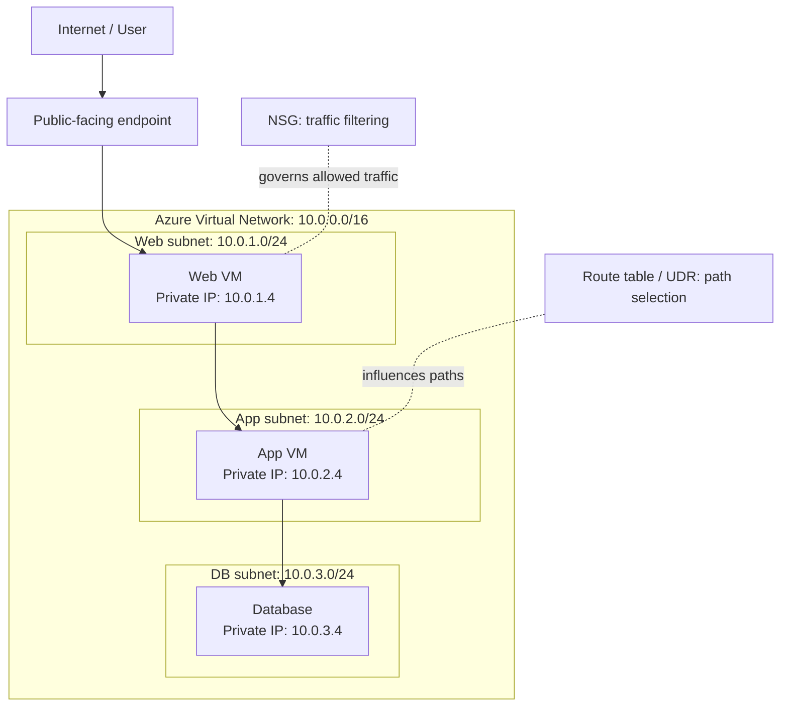
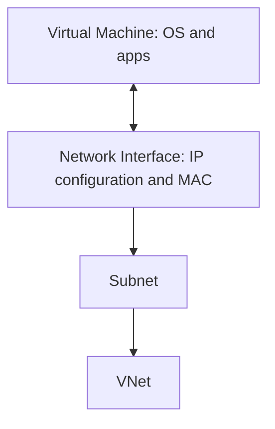
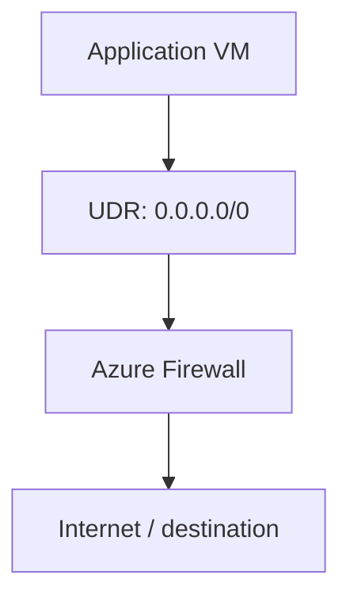

# Azure Networking

## Contents

-   [1. Azure Networking at a glance](#1-azure-networking-at-a-glance)
-   [2. IPv4](#2-ipv4--internet-protocol-version-4)
-   [3. VNet](#3-vnet--azure-virtual-network)
-   [4. Subnet](#4-subnet)
-   [5. Public IP](#5-public-ip)
-   [6. Private IP](#6-private-ip)
-   [7. CIDR](#7-cidr--classless-inter-domain-routing)
-   [8. NIC](#8-nic--network-interface)
-   [9. NSG](#9-nsg--network-security-group)
-   [10. Route Table](#10-route-table)
-   [11. UDR](#11-udr--user-defined-route)
-   [12. How the pieces work together](#12-how-the-pieces-work-together)
-   [13. Troubleshooting workflow](#13-troubleshooting-workflow)
-   [14. Quick reference](#14-quick-reference)

------------------------------------------------------------------------

## 1. Azure Networking at a glance

Azure Networking is a collection of services and capabilities that let
Azure resources communicate with one another, with on-premises networks,
and---with suitable configuration---with the internet.

## 2. IPv4 --- Internet Protocol Version 4

IPv4 is an addressing system used to identify network interfaces and
route IP packets. An IPv4 address contains **32 bits**, displayed as
four decimal octets.

Example: `192.168.1.10`

### Expand: how an IPv4 address is
structured

  Octet     Decimal 8-bit binary
  ------- --------- --------------
  1             192 `11000000`
  2             168 `10101000`
  3               1 `00000001`
  4              10 `00001010`

Each octet is 8 bits, so its value ranges from 0 to 255. The total
number of possible IPv4 bit patterns is (2\^{32} = 4,294,967,296).

### Private IPv4 ranges

  CIDR               Range
  ------------------ ------------------------------------
  `10.0.0.0/8`       `10.0.0.0` -- `10.255.255.255`
  `172.16.0.0/12`    `172.16.0.0` -- `172.31.255.255`
  `192.168.0.0/16`   `192.168.0.0` -- `192.168.255.255`

These ranges are intended for private networking and are not globally
routable on the public internet. Different organizations can reuse the
same private ranges, but overlapping ranges can complicate connectivity
between networks.

**Azure use:** A VNet is configured with address space, and its subnets
allocate address ranges from that space.

## 3. VNet --- Azure Virtual Network

A **Virtual Network (VNet)** is Azure's logically isolated private
network. It provides the network foundation for supported Azure
resources to communicate using private IP addressing.

Example:

-   VNet: `vnet-prod`
-   Address space: `10.0.0.0/16`
-   Web subnet: `10.0.1.0/24`
-   Database subnet: `10.0.2.0/24`

### Expand: what a VNet provides

-   An IP address space for private networking.
-   Subnets to organize resources and apply policies.
-   Connectivity between supported resources, subject to routing and
    security configuration.
-   Integration with services such as VNet peering, VPN Gateway, and
    ExpressRoute.
-   A place to apply network design boundaries.

A VNet is created in an Azure region. To connect it to an on-premises
network, organizations commonly use Site-to-Site VPN or ExpressRoute,
depending on requirements.

### Address planning matters

If an office network and an Azure VNet both use `10.0.0.0/16`,
connecting them can create overlapping address ranges. Plan address
spaces before deploying production networks.

**Remember:** A VNet is not automatically public just because it exists.
Internet exposure depends on public endpoints and the network
configuration around them.

## 4. Subnet

A **subnet** is a smaller logical segment of a VNet's address space.

Example:

-   Web: `10.0.1.0/24`
-   App: `10.0.2.0/24`
-   Database: `10.0.3.0/24`

Subnets help organize workloads and apply different network policies.
For example, a database subnet can have stricter inbound rules than a
web subnet.

### Expand: Azure subnet details

Azure reserves five IPv4 addresses in each IPv4 subnet. Therefore, a
`/24` has 256 total addresses but 251 usable addresses for Azure subnet
allocation.

Subnets do **not** automatically guarantee complete isolation. Use NSGs,
routing, firewalls, and service-specific controls where required.

Some Azure services require dedicated subnets or impose subnet-size
requirements. Always check the requirements of the service being
deployed.

## 5. Public IP

A **Public IP address** is globally routable and can be used for
internet-facing connectivity when associated with a supported Azure
resource and configured correctly.

Common examples include public-facing load balancers, Application
Gateway, VPN Gateway, or a VM NIC configuration where supported.

### Expand: what a Public IP does---and does not
do

A Public IP gives an endpoint a public address; it does not
automatically make an application reachable. Connectivity may also
depend on:

-   NSG and firewall rules.
-   Routes and the resource's network design.
-   The application running and listening on the expected port.
-   Guest OS firewall settings.
-   The resource supporting that Public IP association.

### Static and dynamic allocation

Allocation options depend on the Public IP SKU and Azure's current
feature support. Basic Public IP SKU has been retired; for new designs,
check current Standard SKU requirements and supported allocation options
in Azure documentation.

### Public IP versus NAT

A Public IP is an address. NAT (Network Address Translation) is a
process that translates addresses and, in some cases, ports. Azure NAT
Gateway is commonly used for outbound internet connectivity and is not a
general-purpose inbound connection gateway.

## 6. Private IP

A **Private IP address** is used for communication within private
networks. Example: `10.0.2.4` for an application VM.

Azure assigns private IP configuration to a VM through its network
interface (NIC) and subnet.

### Expand: dynamic and static private
IPs

-   **Dynamic:** Azure allocates an address from the subnet according to
    the IP configuration. "Dynamic" does not mean the address changes
    constantly.
-   **Static:** A specific available address is selected and retained
    according to the configuration and resource lifecycle.

A VM without a Public IP can still have outbound internet connectivity
through NAT Gateway, Azure Firewall, or other supported outbound
mechanisms. Inbound internet connectivity to a private IP is not
directly available from the public internet.

**Private does not automatically mean secure.** NSGs, routes, firewalls,
identity, and application security still matter.

## 7. CIDR --- Classless Inter-Domain Routing

CIDR notation expresses an IP network range using a prefix length.

Example: `10.0.1.0/24`

-   IPv4 has 32 bits.
-   `/24` means 24 prefix bits.
-   Remaining address bits: `32 - 24 = 8`.
-   Total addresses: (2\^8 = 256).
-   Azure usable IPv4 addresses in that subnet: `256 - 5 = 251`.

### Expand: CIDR sizing reference

  -----------------------------------------------------------------------
  CIDR                 Address bits         Total IPv4  Azure usable IPv4
                          remaining          addresses     addresses in a
                                                                   subnet
  -------------- ------------------ ------------------ ------------------
  `/16`                          16             65,536             65,531

  `/20`                          12              4,096              4,091

  `/24`                           8                256                251

  `/25`                           7                128                123

  `/26`                           6                 64                 59

  `/27`                           5                 32                 27

  `/28`                           4                 16                 11
  -----------------------------------------------------------------------

Usable counts assume the range is available for one Azure IPv4 subnet
and account for Azure's five reserved addresses.

**Rule of thumb:** A smaller prefix number means a larger network. For
example, `/16` contains more addresses than `/24`.

### Example subnet sizing

  Workload        Example subnet     Azure usable addresses
  --------------- ---------------- ------------------------
  Web tier        `/24`                                 251
  App tier        `/25`                                 123
  Database tier   `/26`                                  59

Subnet ranges must be non-overlapping and contained within the VNet
address space.

## 8. NIC --- Network Interface

An Azure **Network Interface (NIC)** is the virtual network interface
that connects a VM to a VNet.

A NIC can have IP configurations, a private IP, a MAC address, and
applicable security associations. Public IP association is supported
only in relevant configurations.

### Expand: NIC and VM relationship

Example:

-   VM: `vm-web-01`
-   NIC: `nic-web-01`
-   Subnet: `10.0.1.0/24`
-   Private IP: `10.0.1.4`

The VM uses its NIC to communicate over the virtual network. A VM can
have multiple NICs in supported configurations, but that alone does not
automatically route traffic between interfaces. Guest OS routing, Azure
routing, and security settings still matter.

## 9. NSG --- Network Security Group

An **NSG** filters inbound and outbound traffic using security rules. It
can be associated with a subnet or a NIC.

### Rule fields

  Field              Meaning
  ------------------ ----------------------------------------
  Source             Where traffic originates
  Source port        Source port or range
  Destination        Where traffic is going
  Destination port   Target port or range
  Protocol           TCP, UDP, or supported protocol option
  Direction          Inbound or outbound
  Priority           Evaluation order
  Action             Allow or deny

### Expand: NSG priority and statefulness

Lower priority numbers are evaluated before higher priority numbers. For
example, priority `100` is evaluated before priority `200`.

Illustrative inbound intent:

-   Priority `100`: allow TCP 443 from approved sources.
-   Priority `200`: deny other inbound traffic.

Actual rules must be designed around required sources, destinations,
ports, and the default NSG rules. NSGs are stateful: response traffic
for an allowed connection is generally permitted automatically, but a
separate new connection is evaluated independently.

### NSG versus Azure Firewall

-   **NSG:** Distributed traffic filtering at subnet or NIC level.
-   **Azure Firewall:** Managed centralized firewall service with
    network/application filtering capabilities and supported NAT rules.

They can be used together; one is not a universal replacement for the
other.

## 10. Route Table

A **Route Table** is an Azure resource that holds routes. A route
specifies a destination address prefix and the next hop used for traffic
matching that destination.

Common next-hop types include Virtual network, Internet, Virtual
appliance, Virtual network gateway, and None, subject to Azure routing
support and context.

### Expand: system routes and longest prefix
match

Azure creates system routes automatically for platform and connectivity
behavior. You do not need to manually define every route.

Illustrative routes:

  -----------------------------------------------------------------------
  Destination prefix      Next hop                Meaning
  ----------------------- ----------------------- -----------------------
  `10.0.0.0/16`           Virtual network         VNet address space

  `0.0.0.0/0`             Internet                Default route for
                                                  otherwise unmatched
                                                  IPv4 destinations,
                                                  subject to effective
                                                  routing

  `10.1.0.0/16`           Virtual appliance       Send matching traffic
                                                  to a configured
                                                  appliance
  -----------------------------------------------------------------------

Azure routing uses **longest prefix match**: a more-specific matching
route is preferred over a less-specific one. For example, `/24` is more
specific than `/16`.

Actual route selection also considers Azure's route-source and platform
rules. Inspect effective routes rather than assuming a single
route-table entry explains all traffic behavior.

## 11. UDR --- User-Defined Route

A **User-Defined Route (UDR)** is a custom route added to an Azure Route
Table to influence traffic paths.

Example: A company wants application-subnet traffic destined for the
internet to pass through Azure Firewall for inspection.

Illustrative UDR:

  Setting              Value
  -------------------- ---------------------------
  Destination prefix   `0.0.0.0/0`
  Next-hop type        Virtual appliance
  Next-hop IP          `10.0.0.4` (example only)
  Associated subnet    Application subnet

The next-hop IP above is illustrative. Use the actual supported
firewall/appliance address and route design for the environment.

### Expand: UDR does not filter traffic

A UDR controls route selection; it does not itself inspect or allow/deny
traffic. To force traffic through a firewall successfully, you also
need:

-   A correct route table and subnet association.
-   A reachable next-hop appliance.
-   Appropriate firewall policy.
-   Valid return routing and no unintended asymmetric path.
-   NSG and other required security rules.

A Route Table is the resource; a UDR is an individual custom route
inside it. The route table is associated with the subnet where the
custom route should apply.

## 12. How the pieces work together

Example address plan:

  Component           Example
  ------------------- ---------------
  VNet                `10.0.0.0/16`
  Web subnet          `10.0.1.0/24`
  App subnet          `10.0.2.0/24`
  DB subnet           `10.0.3.0/24`
  Web VM private IP   `10.0.1.4`
  App VM private IP   `10.0.2.4`
  DB VM private IP    `10.0.3.4`

Traffic flow for a web request:

1.  The user resolves the application name through DNS.
2.  The user connects to a configured public-facing endpoint, if the
    application is internet-facing.
3.  The web tier forwards a request to the application tier.
4.  The application tier connects to the database using its private IP.
5.  Azure routing selects the applicable path.
6.  NSGs and any firewalls enforce traffic policy.
7.  The database responds if the application and network configuration
    allow it.

The response path also matters. Correct addressing, a valid route,
allowed traffic, and a running service are all needed.

## 13. Troubleshooting workflow

If a web VM cannot connect to a database VM, investigate in this order:

1.  Verify the destination private IP and subnet range.
2.  Check the VM NIC and IP configuration.
3.  Check applicable NSG rules at subnet and NIC level.
4.  Inspect effective routes and associated route tables.
5.  If a UDR points to a firewall or virtual appliance, verify next-hop
    reachability and policy.
6.  Check the destination OS firewall and whether the application is
    listening on the expected port.
7.  Use Azure Network Watcher tools such as Connection Troubleshoot and
    IP flow verification where appropriate.

Avoid changing random settings before identifying which layer is
failing.

## 14. Quick reference

  Term          One-line meaning
  ------------- ----------------------------------------------------------
  IPv4          32-bit IP addressing format
  VNet          Azure logically isolated private network
  Subnet        Smaller logical address segment inside a VNet
  Public IP     Globally routable address for public-facing connectivity
  Private IP    Address used for private network communication
  CIDR          Prefix notation defining an IP address range
  NIC           VM's virtual network interface
  NSG           Rule-based inbound/outbound traffic filter
  Route Table   Azure resource holding routes
  UDR           Custom route that influences the traffic path

### Mental model to remember

-   **Addressing:** IPv4, CIDR, Public IP, Private IP.
-   **Structure/connectivity:** VNet, Subnet, NIC.
-   **Security:** NSG.
-   **Routing:** Route Table, UDR.

------------------------------------------------------------------------

## Official documentation

-   [Virtual
    networks](https://learn.microsoft.com/azure/virtual-network/virtual-networks-overview)
-   [Virtual network
    subnets](https://learn.microsoft.com/azure/virtual-network/virtual-network-manage-subnet)
-   [Public IP
    addresses](https://learn.microsoft.com/azure/virtual-network/ip-services/public-ip-addresses)
-   [Private IP
    addresses](https://learn.microsoft.com/azure/virtual-network/ip-services/private-ip-addresses)
-   [Network security
    groups](https://learn.microsoft.com/azure/virtual-network/network-security-groups-overview)
-   [Virtual network traffic
    routing](https://learn.microsoft.com/azure/virtual-network/virtual-networks-udr-overview)
-   [Network
    interfaces](https://learn.microsoft.com/azure/virtual-network/virtual-network-network-interface)

