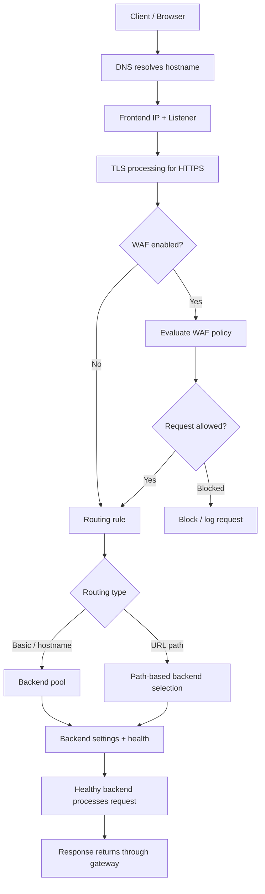
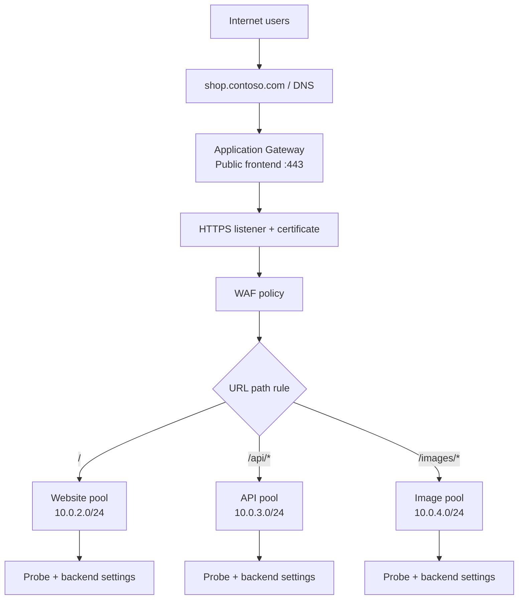

<div align="center">

# Azure Application Gateway
### Visual Deep-Dive • Architecture • Components • Security • Troubleshooting


**A practical, visual guide to Azure's web traffic load balancer**

</div>

---

## At a glance

Azure Application Gateway is a managed **Layer 7 web traffic load balancer**. It routes HTTP/HTTPS requests using information such as hostnames and URL paths. It also supports TLS termination, backend health probes, rewrites, redirects, and Web Application Firewall (WAF) capabilities on supported SKUs.

| Requirement | Application Gateway feature |
|---|---|
| Route `/api/*` separately from `/images/*` | Path-based routing |
| Host multiple websites | Multi-site listeners |
| Accept HTTPS traffic | HTTPS listener and certificate |
| Avoid unhealthy backend targets | Health probes |
| Inspect requests for common web attack patterns | WAF policy on WAF SKU |
| Change supported HTTP headers or URL parts | Rewrite rules |
| Redirect HTTP to HTTPS | Redirect configuration |

> **SKU note:** This guide focuses on Application Gateway v2 (Standard_v2 and WAF_v2). Microsoft retired the v1 SKU family on April 28, 2026. Verify current capabilities and limits in Microsoft Learn before deploying.

## Contents

- [1. What is Application Gateway?](#1-what-is-application-gateway)
- [2. Official Microsoft diagrams](#2-official-microsoft-diagrams)
- [3. Application Gateway vs Load Balancer](#3-application-gateway-vs-azure-load-balancer)
- [4. Request flow](#4-request-flow)
- [5. Components in detail](#5-components-in-detail)
- [6. Routing patterns](#6-routing-patterns)
- [7. TLS and certificates](#7-tls-and-certificates)
- [8. WAF](#8-web-application-firewall-waf)
- [9. Health probes](#9-health-probes-and-backend-health)
- [10. Network, availability, and scaling](#10-network-availability-and-scaling)
- [11. Practical example](#11-practical-example)
- [12. Deployment checklist](#12-deployment-checklist)
- [13. Troubleshooting](#13-troubleshooting)
- [14. Best practices](#14-best-practices)
- [15. Official references](#official-microsoft-references)

---

## 1. What is Application Gateway?

**Azure Application Gateway** is a managed application delivery controller (ADC) for web traffic. It acts as a single entry point and forwards accepted requests to configured backend targets.

Unlike a traditional Layer 4 load balancer, it can use HTTP-level information—such as the hostname or URL path—to decide where a request should go.

### Example

A company hosts three application areas:

- `https://shop.contoso.com/` → storefront
- `https://shop.contoso.com/api/*` → API service
- `https://shop.contoso.com/images/*` → image service

Application Gateway can use one HTTPS listener and a path-based rule to send these requests to different backend pools.

### Why Layer 7 matters

- **Layer 7:** understands web requests and can route by hostname and URL path.
- **Regional service:** deployed into a virtual network and region.
- **Managed service:** Azure manages the gateway infrastructure; you configure routing, backend targets, probes, security, and monitoring.

Application Gateway does not replace secure application code, authentication, patching, or a complete network-security design.

---

## 2. Official Microsoft diagrams

The following diagrams are hosted by Microsoft Learn and embedded directly from the official documentation media URLs.

### Diagram A — Application Gateway components


<sub>Source: [Microsoft Learn — Application Gateway components](https://learn.microsoft.com/en-us/azure/application-gateway/application-gateway-components)</sub>

**How to read the diagram:**

1. **Frontend IP** is the gateway's entry address.
2. **Listener** checks the incoming IP, port, protocol, and hostname configuration.
3. **Rule** connects the listener to backend handling.
4. **Backend pool** identifies destination servers.
5. **Backend HTTP settings** define how the gateway connects to those servers.
6. **Custom probe** monitors backend health.
7. **Certificate** supports client-side TLS for an HTTPS listener.

### Diagram B — Routing configuration and path-based backends


<sub>Source: [Microsoft Learn — Application Gateway configuration overview](https://learn.microsoft.com/en-us/azure/application-gateway/configuration-overview)</sub>

This diagram shows how listeners, routing rules, backend pools, backend settings, probes, and TLS trust settings fit together. Creating a backend pool or probe alone is not enough: the related settings must be associated with the relevant routing configuration.

---

## 3. Application Gateway vs Azure Load Balancer

| Feature | Application Gateway | Azure Load Balancer |
|---|---|---|
| Primary layer | Layer 7 web routing | Layer 4 network-flow distribution |
| Traffic | HTTP/HTTPS and supported web features | TCP/UDP flows |
| Routing decisions | Hostname, URL path, supported HTTP attributes | Network flow, protocol, and ports |
| TLS termination | Supported | Not its primary role |
| WAF | Supported on WAF SKUs | No built-in Layer 7 WAF |
| Typical use | Websites, APIs, multi-site routing | TCP/UDP workloads |

Choose **Application Gateway** for web-aware routing, HTTPS handling, or WAF. Choose **Azure Load Balancer** for Layer 4 TCP/UDP distribution. The services can be combined in a larger design.

---

## 4. Request flow



### Step-by-step

1. **DNS:** The client resolves the hostname to the gateway frontend address.
2. **Listener:** The gateway accepts the connection if IP, port, protocol, and hostname match.
3. **TLS:** For HTTPS, the gateway uses its configured certificate for the client-side TLS session.
4. **WAF:** If configured, the request is evaluated against the WAF policy.
5. **Routing:** The rule selects a backend pool or a path-based routing map.
6. **Backend settings:** The gateway applies protocol, port, timeout, host handling, and other configured settings.
7. **Health:** Normal requests are sent to eligible backend targets.
8. **Response:** The backend response returns through the gateway to the client.

---

## 5. Components in detail

Core relationship:

**Frontend → Listener → Request-routing rule → Backend pool + Backend settings → Healthy backend**

WAF, TLS configuration, probes, redirects, rewrites, networking, and diagnostics support this request path.

### 5.1 Frontend IP configuration

The frontend is the address clients connect to.

- **Public frontend:** for internet-facing applications.
- **Private frontend:** for applications accessed over private network connectivity.
- Supported combinations depend on the current SKU and deployment configuration.

**Example:** `shop.contoso.com` resolves to the public frontend IP. Clients connect to the gateway, not directly to each backend VM.

A frontend IP alone does not make an application reachable. DNS, listeners, rules, network controls, and healthy backends must also be correct.

### 5.2 Frontend port

The frontend port is where the listener accepts connections. Common examples are TCP `80` for HTTP and TCP `443` for HTTPS.

The client-facing port is separate from the backend port, which is configured in backend settings.

### 5.3 Listener

A **listener** checks incoming connections against configured properties:

- Frontend IP configuration
- Port and protocol
- Hostname, if configured
- TLS certificate for HTTPS

**Basic listener:** for a straightforward site-to-backend mapping.

**Multi-site listener:** matches a configured hostname so multiple websites can share gateway infrastructure.

**Example:** An HTTPS listener for `api.contoso.com` accepts matching requests on port `443`.

A listener accepts traffic; the associated routing rule determines what happens next.

### 5.4 TLS/SSL certificate

For HTTPS, the gateway presents a certificate to the client. The certificate should cover the hostname users access.

Plan for hostname coverage, expiry/renewal, secure private-key handling, and supported certificate integration options.

The client-facing certificate and backend server certificate have different roles. If the gateway connects to a backend over HTTPS, backend certificate validation and trust configuration must also be correct.

### 5.5 Request-routing rule

A rule connects a listener to backend behavior.

- **Basic rule:** sends matching requests to one backend pool using associated backend settings.
- **Path-based rule:** selects backend pools/settings according to the URL path.
- **Redirect rule behavior:** can redirect requests where supported.

**Example:** `/api/*` requests go to the API pool; other requests use the default website pool.

### 5.6 Backend pool

The backend pool identifies destinations that can serve requests. Supported targets can include Azure VMs, Virtual Machine Scale Set instances, IP addresses, FQDNs, and supported App Service or other backend targets.

| Example target | Role |
|---|---|
| `10.0.2.4` | Storefront VM 1 |
| `10.0.2.5` | Storefront VM 2 |
| `api.contoso.internal` | API backend |

Targets must be reachable from the gateway and configured for the intended protocol, port, host handling, and health probe.

### 5.7 Backend settings (HTTP settings)

Backend settings define how the gateway connects to a selected backend. Depending on configuration, they can include:

- Backend protocol: HTTP or HTTPS
- Backend port
- Request timeout
- Hostname or host-header override
- Cookie-based session affinity
- Backend TLS validation and trusted root certificates
- Custom probe association
- Connection draining and other supported behaviors

**Example:** The client connects to the gateway over HTTPS on port `443`; the gateway terminates that TLS session and creates a separate HTTPS connection to the backend on port `443`.

Client-to-gateway TLS and gateway-to-backend TLS are separate. If the backend protocol is HTTP, that segment is not TLS-encrypted.

### 5.8 Health probe

A health probe checks whether a backend responds according to configured criteria. Settings may include protocol, hostname, path such as `/health`, port, interval, timeout, unhealthy threshold, and expected response codes.

If a VM repeatedly fails the configured probe, it can be marked unhealthy and excluded from normal request distribution.

**Good practice:** The endpoint should represent the application's ability to serve requests. A probe that always returns success can conceal real failures. A custom probe must be associated with the relevant backend settings and routing configuration.

### 5.9 Path-based routing map

Path-based routing sends requests to different backend pools according to the URL path.

| Request path | Destination |
|---|---|
| `/` | Website pool |
| `/api/*` | API pool |
| `/images/*` | Image pool |
| `/admin/*` | Admin pool with appropriate access controls |

Path matching uses the URL path, not query parameters. Requests that don't match configured patterns use the configured default backend behavior.

### 5.10 Multi-site hosting

Different hostnames can share a gateway, with listeners and rules configured for each site.

```text
www.contoso.com   → Website pool
api.contoso.com   → API pool
shop.contoso.com  → Shopping pool
```

DNS, listener hostname configuration, and HTTPS certificate coverage must align.

### 5.11 Web Application Firewall (WAF) policy

On supported WAF SKUs, WAF inspects HTTP/HTTPS requests for patterns associated with common web attacks, such as SQL injection and cross-site scripting.

A policy can include managed rules, custom rules, exclusions, and supported operating modes.

| Mode | Behavior |
|---|---|
| Detection | Logs matching requests for investigation |
| Prevention | Can block requests matching configured blocking conditions |

**Safer rollout:** test the policy, review logs for false positives, use narrowly scoped exclusions only when justified, and enable prevention after validation. WAF does not replace secure code, authentication, authorization, patching, or monitoring.

### 5.12 Rewrite rules

Rewrite rules modify supported request/response headers and URL components as traffic passes through the gateway.

**Example:** Add or update a supported HTTP header before forwarding a request.

Routing decides where a request goes; rewriting changes supported parts of the request or response.

### 5.13 Redirect configuration

A redirect tells the client to request another URL or protocol. A common example is redirecting `http://shop.contoso.com` to `https://shop.contoso.com`.

A redirect usually causes a new client request; a rewrite changes supported request details inside gateway processing.

### 5.14 Cookie-based session affinity

Session affinity can use a gateway-managed cookie to keep a client associated with the same backend, where enabled and supported. This can help applications that keep local session state, but it is not a substitute for resilient session design. Shared session storage or stateless authentication may be more robust when backend instances change or fail.

### 5.15 Autoscaling and capacity

Application Gateway supports autoscaling in supported configurations. Gateway scaling is separate from backend scaling: a gateway can have sufficient capacity while application servers are overloaded.

Plan for expected request volume, concurrency, backend capacity, load testing, monitoring, and scaling limits.

### 5.16 Availability zones and high availability

Where supported by the SKU and region, zone redundancy can improve resilience to a zone-level failure.

High availability also depends on multiple healthy backend instances, accurate probes, resilient application design, DNS/certificate management, network configuration, and monitoring.

### 5.17 Dedicated subnet and networking

Application Gateway is deployed into a **dedicated subnet** in a VNet. Follow current Azure requirements for subnet sizing, NSGs, supported routes, and resource placement.

Verify:
- The subnet is dedicated to Application Gateway.
- NSGs allow required gateway operations and backend traffic.
- UDRs, if used, follow supported routing requirements.
- Backend IPs/FQDNs are reachable and resolve correctly.
- Private clients have a valid network path to a private frontend.

### 5.18 Diagnostics, logs, and metrics

Azure Monitor integration helps investigate request handling, backend health, performance, and WAF activity. Depending on SKU and enabled diagnostic categories, telemetry can include access logs, performance logs, WAF logs, backend health, and capacity metrics.

Configure diagnostic settings to send logs to a suitable destination, such as Log Analytics, when centralized analysis is needed.

---

## 6. Routing patterns

### Basic routing

One listener sends matching requests to one backend pool using associated backend settings.

### Path-based routing

```text
https://shop.contoso.com/          → Storefront
https://shop.contoso.com/api/      → API
https://shop.contoso.com/images/   → Image service
```

### Multi-site routing

```text
www.contoso.com   → Storefront
api.contoso.com   → API
admin.contoso.com → Admin portal
```

**Remember:** DNS directs the client to the gateway. The listener and routing rule determine how the gateway handles the request.

---

## 7. TLS and certificates

### TLS termination at the gateway

```text
Client -- HTTPS --> Application Gateway -- HTTP --> Backend
```

The gateway decrypts the client connection and forwards HTTP to the backend. The gateway-to-backend segment is not TLS-encrypted. Use this only when security requirements and network design permit it.

### End-to-end TLS

```text
Client -- HTTPS --> Application Gateway -- HTTPS --> Backend
```

The gateway terminates client-side TLS and creates a separate TLS connection to the backend. Configure backend certificate trust and hostname validation correctly.

- **Listener certificate:** presented to the client.
- **Backend certificate:** presented by the backend when HTTPS is used.
- **Trusted root configuration:** establishes trust in applicable backend TLS configurations.
- **Hostname/SNI:** must align with backend certificate and hostname settings.

Frontend HTTPS does not automatically mean the gateway-to-backend connection is encrypted.

---

## 8. Web Application Firewall (WAF)

WAF provides HTTP-aware inspection on supported Application Gateway WAF SKUs. Depending on policy and rule coverage, it can detect or block request patterns associated with common web attacks.

### Recommended rollout

1. Select a suitable WAF SKU and policy.
2. Review managed and custom rules.
3. Test in detection mode where appropriate.
4. Review logs for false positives.
5. Add narrowly scoped exclusions only when justified.
6. Enable prevention after validation.
7. Monitor and tune the policy as the application evolves.

WAF is one layer of defense, not a guarantee against every attack.

---

## 9. Health probes and backend health

| Component | Question it answers |
|---|---|
| Listener | Should the gateway accept this connection? |
| Routing rule | Which backend behavior applies? |
| Backend settings | How should the gateway connect? |
| Health probe | Is the backend responding as expected? |
| Backend pool | Which destinations are configured? |
| WAF policy | Does the request match configured security rules? |

If a backend is unhealthy, check the probe protocol/port/path/hostname, application listener, expected response, backend NSG and OS firewall, gateway-to-backend connectivity, and TLS certificate validation.

---

## 10. Network, availability, and scaling

### Deployment sequence

1. Plan the VNet and dedicated Application Gateway subnet.
2. Select a supported SKU and availability configuration.
3. Configure public or private frontend.
4. Create listeners and TLS certificates.
5. Define backend pools and backend settings.
6. Configure probes and associate them correctly.
7. Create routing rules and path maps.
8. Configure WAF if required.
9. Point DNS to the intended frontend.
10. Validate NSGs, routes, backend reachability, and TLS.
11. Enable logs, metrics, and alerts.
12. Test normal operation, unhealthy backends, and expected traffic load.

### Network security principles

- Keep backend resources private unless public access is explicitly required.
- Allow only required gateway-to-backend traffic.
- Avoid exposing backend management ports publicly.
- Follow current requirements for the gateway subnet.
- Verify backend FQDN resolution.
- Ensure private clients have network connectivity to private frontends.

---

## 11. Practical example

A company has a storefront, API, and image service. Users connect over HTTPS while backend services remain on private IPs.



| URL | Rule | Backend |
|---|---|---|
| `https://shop.contoso.com/` | Default path | Website pool |
| `https://shop.contoso.com/api/orders` | `/api/*` | API pool |
| `https://shop.contoso.com/images/logo.png` | `/images/*` | Image pool |

If the API backend becomes unhealthy, the probe can mark that target unhealthy. If every API target is unhealthy, `/api/*` requests may fail even while the storefront remains healthy. Separate pools and probes help isolate failures between application components.

---

## 12. Deployment checklist

| Area | Verify |
|---|---|
| SKU | Supports required routing, WAF, scaling, and availability features |
| VNet/subnet | Dedicated subnet, correct region, suitable size |
| Frontend | Public/private choice matches access requirements |
| DNS | Hostname resolves to the intended frontend |
| Listener | IP, port, protocol, hostname, and certificate are correct |
| Routing rule | Basic, multi-site, or path-based behavior matches design |
| Backend pool | Targets are registered and reachable |
| Backend settings | Protocol, port, host handling, timeout, TLS trust are correct |
| Probe | Accurately represents backend readiness |
| WAF | Policy is tested, monitored, and tuned |
| Network security | NSGs/firewalls allow only required traffic |
| Observability | Logs, metrics, and alerts are enabled |
| Capacity | Gateway and backend tiers can handle expected demand |

---

## 13. Troubleshooting

### Website does not open
Check DNS → frontend IP → listener port/protocol/hostname → certificate → routing rule → backend health → NSGs/firewalls → application listener.

### Backend is unhealthy
Check probe protocol, port, path, hostname, expected response, application listener, backend network rules, and backend TLS certificate validation.

### One path works but another fails
Check path patterns, rule association, default backend behavior, backend pool mapping, backend settings, probe health, and WAF logs.

### HTTPS works for one hostname but not another
Check DNS, listener hostname, certificate coverage and expiry, multi-site routing, and listener-to-rule association.

### Backend-related gateway error
Check backend health, reachability, port, host header, backend protocol, certificate trust, application logs, and gateway access/performance logs.

**Recommended diagnostic order:**

`DNS → Frontend → Listener → TLS/WAF → Routing rule → Backend settings → Backend health → Network security → Application logs`

---

## 14. Best practices

- Use Application Gateway when HTTP-aware routing or WAF is required.
- Follow current guidance for a dedicated, correctly sized subnet.
- Keep backends private unless public access is explicitly needed.
- Evaluate end-to-end TLS and validate backend certificates.
- Build health endpoints that reflect real application readiness.
- Use separate backend pools/probes for distinct services where appropriate.
- Test path-based and multi-site routing before production.
- Tune WAF policies and monitor false positives.
- Enable diagnostics, metrics, and alerts.
- Plan gateway capacity and backend scaling together.
- Validate DNS, NSGs, routes, certificates, and application listeners.
- Check Microsoft Learn for current SKU-specific capabilities and limits.

---

## 15. Key takeaways

- Application Gateway is a Layer 7 web traffic load balancer.
- Listeners accept matching connections; routing rules decide how requests are handled.
- Backend pools define destinations; backend settings define gateway-to-backend connections.
- Health probes determine which targets are considered healthy.
- Frontend TLS and backend TLS are separate configuration decisions.
- WAF is available on supported WAF SKUs and requires a suitable policy.
- Application Gateway and Azure Load Balancer solve different problems and can be combined.
- High availability depends on healthy backends, correct network controls, and resilient application design.

---

## Official Microsoft references

- [Azure Application Gateway overview](https://learn.microsoft.com/en-us/azure/application-gateway/overview)
- [Application Gateway components](https://learn.microsoft.com/en-us/azure/application-gateway/application-gateway-components)
- [Configuration overview](https://learn.microsoft.com/en-us/azure/application-gateway/configuration-overview)
- [How Application Gateway works](https://learn.microsoft.com/en-us/azure/application-gateway/how-application-gateway-works)
- [Listener configuration](https://learn.microsoft.com/en-us/azure/application-gateway/configuration-listeners)
- [TLS/SSL overview](https://learn.microsoft.com/en-us/azure/application-gateway/ssl-overview)
- [WAF on Application Gateway](https://learn.microsoft.com/en-us/azure/web-application-firewall/ag/ag-overview)
- [Architecture best practices](https://learn.microsoft.com/en-us/azure/architecture/framework/services/networking/azure-application-gateway)

---

<div align="center">

**Azure Application Gateway · Visual learning and deployment reference**

</div>
