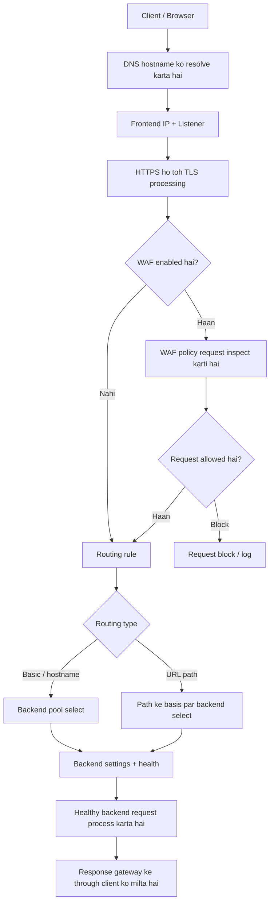
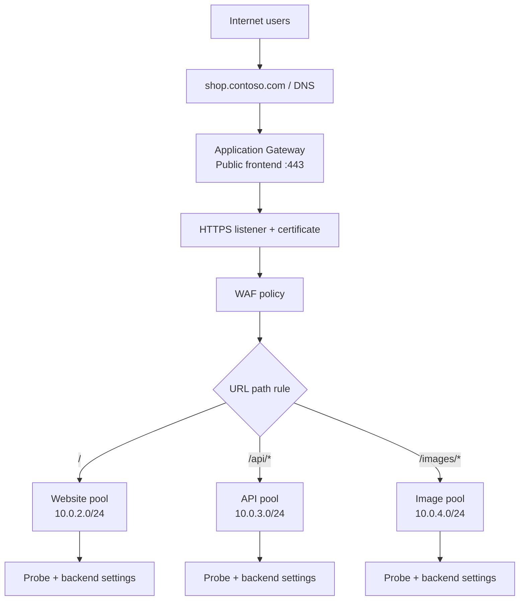

<div align="center">

# Azure Application Gateway


**Web traffic ko samajhne, route karne aur secure karne ke liye practical guide**

</div>

---


## Quick summary

**Azure Application Gateway** ek Azure-managed **Layer 7 (Application Layer) web traffic load balancer** hai. Ye HTTP/HTTPS request ko samajh kar decide karta hai ki request kis backend server ya service tak jaani chahiye. Ye hostname aur URL path ke basis par routing, HTTPS/TLS termination, backend health checks, redirects, rewrites aur supported SKU par Web Application Firewall (WAF) provide kar sakta hai.

| Aapko kya karna hai? | Application Gateway ka feature |
|---|---|
| `/api/*` ko API servers par aur `/images/*` ko image servers par bhejna | Path-based routing |
| Ek gateway se multiple domains host karna | Multi-site listeners |
| Website par HTTPS enable karna | HTTPS listener aur TLS certificate |
| Down backend server par traffic bhejne se bachna | Health probes |
| Common web attacks ke request patterns inspect karna | WAF policy, supported WAF SKU par |
| HTTP ko HTTPS par redirect karna | Redirect configuration |
| Supported HTTP headers ya URL parts badalna | Rewrite rules |

> **SKU note:** Ye guide mainly Application Gateway v2 — `Standard_v2` aur `WAF_v2` — par focus karti hai. Microsoft ke current documentation ke mutabik v1 SKU family 28 April 2026 ko retire ho chuki hai. Deployment se pehle current SKU features, limits aur region availability Microsoft Learn par verify karein.

## Contents

- [1. Application Gateway kya hai?](#1-application-gateway-kya-hai)
- [2. Official Microsoft diagrams](#2-official-microsoft-diagrams)
- [3. Application Gateway vs Azure Load Balancer](#3-application-gateway-vs-azure-load-balancer)
- [4. Ek request ka complete flow](#4-ek-request-ka-complete-flow)
- [5. Saare important components](#5-saare-important-components)
- [6. Routing ke common patterns](#6-routing-ke-common-patterns)
- [7. HTTPS aur TLS ko samjhein](#7-https-aur-tls-ko-samjhein)
- [8. WAF kya karta hai?](#8-waf-kya-karta-hai)
- [9. Health probes aur backend health](#9-health-probes-aur-backend-health)
- [10. Network, availability aur scaling](#10-network-availability-aur-scaling)
- [11. Practical architecture example](#11-practical-architecture-example)
- [12. Deployment checklist](#12-deployment-checklist)
- [13. Troubleshooting guide](#13-troubleshooting-guide)
- [14. Production best practices](#14-production-best-practices)
- [15. Important terms aur recap](#15-important-terms-aur-recap)
- [Official Microsoft references](#official-microsoft-references)

---

## 1. Application Gateway kya hai?

Socho aapki company ki ek website hai aur uske peeche multiple services chalti hain:

- Main website / storefront
- REST API
- Images service
- Admin portal

Aap nahi chahte ki har user ko alag-alag backend server ka address pata ho. Aap ek common entry point rakhna chahte ho, jo request dekh kar use sahi service tak bhej de. Azure Application Gateway ye kaam karta hai.

### Simple example

Maan lo website ka domain `shop.contoso.com` hai:

- `https://shop.contoso.com/` → website servers
- `https://shop.contoso.com/api/orders` → API servers
- `https://shop.contoso.com/images/logo.png` → image servers

Application Gateway hostname aur URL path ko dekh kar request ko correct backend pool tak route kar sakta hai.

### Layer 7 ka matlab kya hai?

Networking ko samajhne ke liye OSI model ke layers ka basic idea useful hai. Application Gateway **Layer 7**, yaani Application Layer par web request ke details ke saath kaam karta hai.

- **Layer 4:** TCP/UDP connection, IP address aur port jaise network-level details par focus karta hai.
- **Layer 7:** HTTP/HTTPS jaise application protocols ko samajh sakta hai. Isliye hostname, URL path aur supported HTTP attributes ke basis par routing possible hoti hai.

### Application Gateway kya nahi hai?

Ye aapki application ka replacement nahi hai. Ye application code ko secure likhne, user authentication/authorization, server patching ya data security ki responsibility khatam nahi karta. Ye web traffic ko receive, inspect (configured hone par), route aur manage karne wala managed service hai.

### Kab use karna chahiye?

Application Gateway tab useful hai jab aapko web traffic ke liye hostname/path-based routing, HTTPS termination, backend health checks ya WAF chahiye. Agar sirf TCP/UDP traffic ko distribute karna hai aur HTTP-level features ki zaroorat nahi hai, toh Azure Load Balancer zyada suitable ho sakta hai.

---

## 2. Official Microsoft diagrams

Neeche diye gaye diagrams official Microsoft Learn documentation se directly embed kiye gaye hain.

### Diagram A — Application Gateway ke components


<sub>Source: [Microsoft Learn — Application Gateway components](https://learn.microsoft.com/en-us/azure/application-gateway/application-gateway-components)</sub>

**Diagram ko kaise samjhein?**

1. **Frontend IP** gateway ka entry address hota hai.
2. **Listener** check karta hai ki incoming connection configured IP, port, protocol aur hostname se match karti hai ya nahi.
3. **Routing rule** decide karta hai request ke saath aage kya karna hai.
4. **Backend pool** destination servers/services ko identify karta hai.
5. **Backend settings** batati hain ki gateway backend se kis protocol, port aur settings ke saath connect kare.
6. **Health probe** check karti hai ki backend configured criteria ke hisaab se healthy hai ya nahi.
7. **Certificate** HTTPS listener ke zariye client ke saath TLS connection establish karne mein use hota hai.

### Diagram B — Routing configuration


<sub>Source: [Microsoft Learn — Application Gateway configuration overview](https://learn.microsoft.com/en-us/azure/application-gateway/configuration-overview)</sub>

Is diagram ka key lesson ye hai ki sirf backend pool ya probe create karna enough nahi. Listener, rule, backend pool, backend settings aur probe ko sahi configuration mein associate bhi karna hota hai.

---

## 3. Application Gateway vs Azure Load Balancer

Dono traffic distribute karte hain, lekin unka kaam karne ka layer aur decision-making alag hai.

| Feature | Application Gateway | Azure Load Balancer |
|---|---|---|
| Main layer | Layer 7 — web/application traffic | Layer 4 — network flows |
| Typical protocols | HTTP/HTTPS aur supported web features | TCP/UDP |
| Routing decision | Hostname, URL path aur supported HTTP attributes | Network flow, protocol aur ports |
| TLS termination | Supported | Iska primary purpose nahi |
| Built-in WAF | Supported WAF SKU par | Layer 7 WAF built-in nahi |
| Typical use | Websites, APIs, multi-site routing, web security | TCP/UDP workloads aur network-level distribution |

**Simple rule:** Web request ko hostname/path ke basis par route karna hai toh Application Gateway consider karein. TCP/UDP flows distribute karne hain toh Azure Load Balancer consider karein. Complex architecture mein dono services ek saath bhi use ho sakti hain.

---

## 4. Ek request ka complete flow



### Step-by-step explanation

1. **DNS lookup:** Browser `shop.contoso.com` ka address resolve karta hai. DNS record ko Application Gateway ke intended frontend IP par point karna chahiye.
2. **Frontend IP:** Client gateway ke public ya private frontend address tak connection banata hai.
3. **Listener:** Gateway incoming connection ka frontend IP, port, protocol aur configured hostname check karta hai. Matching listener hona zaroori hai.
4. **TLS processing:** HTTPS listener par gateway configured certificate use karke client ke saath TLS session establish karta hai.
5. **WAF inspection:** Agar WAF policy configured hai, toh request ko policy ke rules ke against evaluate kiya ja sakta hai.
6. **Routing rule:** Rule decide karta hai request ko ek backend pool par bhejna hai, ya URL path ke hisaab se pool choose karna hai.
7. **Backend settings:** Gateway selected backend se connect karne ke liye protocol, port, timeout, host handling aur doosri configured settings apply karta hai.
8. **Backend health:** Normal traffic eligible/healthy backend targets ko bheja jaata hai.
9. **Response:** Backend response gateway se wapas client tak jaata hai.

Agar request fail ho rahi ho, toh isi sequence ko follow karke troubleshoot karna useful hai: DNS → frontend → listener → TLS/WAF → routing rule → backend settings → backend health → network rules → application.

---

## 5. Saare important components

Overall relationship ko is tarah yaad rakhein:

**Frontend IP → Listener → Routing Rule → Backend Pool + Backend Settings → Healthy Backend**

TLS certificate, WAF, health probes, rewrites, redirects, networking aur diagnostics is flow ko secure, reliable aur manageable banane mein help karte hain.

### 5.1 Frontend IP configuration

Frontend IP wo address hai jahan client Application Gateway se connect karta hai.

- **Public frontend:** internet se accessible web application ke liye.
- **Private frontend:** internal users ya private network connectivity ke through access hone wali application ke liye.
- Supported combinations aapke SKU, region aur deployment configuration par depend kar sakte hain.

**Example:** `shop.contoso.com` public frontend IP par resolve hota hai. User gateway tak connect karta hai; ideally user ko backend VM ka direct address access karne ki zaroorat nahi hoti.

Yaad rakhein: sirf frontend IP create karne se website accessible nahi hoti. DNS, listener, routing rule, network configuration aur healthy backend bhi sahi hone chahiye.

### 5.2 Frontend port

Frontend port wo port hai jahan listener incoming connection accept karta hai. Common examples:

- TCP `80` — HTTP
- TCP `443` — HTTPS

Client-facing frontend port aur backend port alag ho sakte hain. Backend port ko backend settings mein configure kiya jaata hai.

### 5.3 Listener

**Listener gateway ka entry-point configuration hai.** Ye check karta hai incoming connection configured properties se match karti hai ya nahi:

- Frontend IP configuration
- Port aur protocol
- Hostname, agar configured ho
- HTTPS ke liye TLS certificate

**Basic listener:** ek simple website ya hostname ko handle karne ke liye.

**Multi-site listener:** configured hostname match karke ek gateway par multiple websites host karne ke liye.

**Example:** `api.contoso.com` ke liye port `443` par HTTPS listener configure ho sakta hai.

Listener traffic accept karne ka decision leta hai; uske baad associated routing rule decide karta hai request ko kahan bhejna hai.

### 5.4 TLS/SSL certificate

HTTPS use karte waqt gateway client ko certificate present karta hai. Certificate ko us hostname ke liye valid hona chahiye jise user access kar raha hai.

Certificate plan karte waqt ye cheezein check karein:

- Certificate mein sahi hostname/SAN coverage ho.
- Certificate expire na ho; renewal process plan ho.
- Private key securely handle ki jaaye.
- Certificate import/integration ka method current Azure requirements ke mutabik ho.

**Important:** Client-facing certificate aur backend server ka certificate alag roles rakhte hain. Agar gateway backend se HTTPS par connect karta hai, toh backend certificate trust aur hostname validation bhi sahi configure honi chahiye.

### 5.5 Request-routing rule

Routing rule listener ko backend handling ke saath connect karta hai.

- **Basic rule:** matching request ko ek backend pool aur uski backend settings ke through bhejta hai.
- **Path-based rule:** URL path ke basis par different backend pools/settings choose kar sakta hai.
- **Redirect configuration:** supported setup mein client ko doosre URL ya protocol par redirect kar sakti hai.

**Example:** `/api/*` requests API pool par aur baaki requests default website pool par jaati hain.

### 5.6 Backend pool

Backend pool un destinations ki list hai jo application request serve kar sakte hain. Supported configuration ke mutabik targets mein Azure VMs, Virtual Machine Scale Set instances, IP addresses, FQDNs, aur supported App Service ya doosre backend targets ho sakte hain.

| Example target | Meaning |
|---|---|
| `10.0.2.4` | Storefront VM 1 |
| `10.0.2.5` | Storefront VM 2 |
| `api.contoso.internal` | API backend ka hostname |

Backend target gateway se network ke through reachable hona chahiye. Protocol, port, host handling aur health probe configuration bhi us backend ke saath match karni chahiye.

### 5.7 Backend settings (HTTP settings)

Backend settings batati hain ki Application Gateway selected backend se **kaise connect karega**. Configuration ke hisaab se inmein ye cheezein ho sakti hain:

- Backend protocol: HTTP ya HTTPS
- Backend port
- Request timeout
- Hostname ya host-header override
- Cookie-based session affinity
- Backend TLS validation aur trusted root certificates
- Custom health probe association
- Supported connection draining aur related behavior

**Example:** Client gateway ko HTTPS port `443` par request bhejta hai. Gateway client-side TLS terminate karke backend se port `443` par ek separate HTTPS connection bana sakta hai.

Client-to-gateway TLS aur gateway-to-backend TLS do separate connections hain. Agar backend protocol HTTP hai, toh gateway aur backend ke beech wala segment TLS-encrypted nahi hota.

### 5.8 Health probe

Health probe ek configured check hai jo dekhti hai ki backend expected tareeke se response de raha hai ya nahi. Probe mein ye settings ho sakti hain:

- Protocol
- Port
- Hostname
- Path, jaise `/health`
- Check interval aur timeout
- Unhealthy threshold
- Expected HTTP response codes/status range

Agar backend baar-baar probe fail kare, toh gateway us target ko unhealthy mark kar sakta hai aur normal request distribution se exclude kar sakta hai.

**Achhi practice:** Probe endpoint application ki actual readiness ko reflect kare. Agar endpoint hamesha success return karta hai, toh real application failure chhup sakti hai. Custom probe ko relevant backend settings ke saath correctly associate karna zaroori hai.

### 5.9 Path-based routing map

Path-based routing URL ke path ke basis par request ko alag backend pool tak bhejti hai.

| Request path | Destination |
|---|---|
| `/` | Website pool |
| `/api/*` | API pool |
| `/images/*` | Image pool |
| `/admin/*` | Admin pool — appropriate access controls ke saath |

Path matching URL path par hoti hai, query parameters par nahi. Agar request configured path patterns se match nahi karti, toh configured default backend behavior apply hota hai.

### 5.10 Multi-site hosting

Alag hostnames ko ek gateway par host kiya ja sakta hai. Iske liye relevant hostname ke listeners aur routing rules configure kiye jaate hain.

```text
www.contoso.com   → Website pool
api.contoso.com   → API pool
shop.contoso.com  → Shopping pool
```

DNS records, listener hostname aur HTTPS certificate coverage ek doosre ke saath align hone chahiye.

### 5.11 Web Application Firewall (WAF) policy

Supported WAF SKU par WAF HTTP/HTTPS requests ko common web attack patterns ke liye inspect kar sakta hai. Examples mein SQL injection aur cross-site scripting (XSS) se associated patterns shamil hain.

WAF policy mein configuration ke mutabik managed rules, custom rules, exclusions aur supported operating modes ho sakte hain.

| Mode | Kya hota hai? |
|---|---|
| Detection | Matching requests ko investigation ke liye log karta hai; policy behavior ko test karne mein useful |
| Prevention | Configured blocking conditions match hone par request block kar sakta hai |

**Safer rollout:** Pehle policy test karein, logs mein false positives dekhein, sirf justified aur narrow exclusions banayein, phir validation ke baad Prevention mode enable karein. WAF secure application code, authentication, authorization, patching aur monitoring ka replacement nahi hai.

### 5.12 Rewrite rules

Rewrite rules traffic gateway se pass hote waqt supported request/response headers aur URL ke supported parts ko modify kar sakte hain.

**Example:** Backend ko forward karne se pehle supported HTTP header add ya update karna.

Routing ka sawal hai: **request kahan jaayegi?** Rewrite ka sawal hai: **request/response ke supported parts ko kaise badla jaayega?**

### 5.13 Redirect configuration

Redirect client ko kisi doosre URL ya protocol par dobara request bhejne ke liye kehta hai. Common example HTTP website ko HTTPS par redirect karna hai:

`http://shop.contoso.com` → `https://shop.contoso.com`

Redirect mein aam taur par browser ek nayi request karta hai. Rewrite gateway ke traffic processing ke dauraan supported request/response details ko modify karta hai. Dono ka behavior alag hai.

### 5.14 Cookie-based session affinity

Session affinity enable hone par gateway-managed cookie client ko same backend ke saath associated rakhne mein help kar sakti hai, jahan supported aur configured ho.

Ye un applications mein useful ho sakti hai jo local server session state rakhti hain. Lekin ye resilient session design ka replacement nahi. Shared session storage ya stateless authentication zyada robust ho sakte hain, khaaskar jab backend instances scale ya fail hote hain.

### 5.15 Autoscaling aur capacity

Supported configurations mein Application Gateway autoscaling support karta hai. Gateway ka scale aur backend application ka scale do alag cheezein hain. Gateway ke paas sufficient capacity ho sakti hai, lekin backend servers overload ho sakte hain.

Expected request volume, concurrent connections, backend capacity, load testing, monitoring aur applicable scaling limits ko saath mein plan karein.

### 5.16 Availability zones aur high availability

SKU aur region support ke hisaab se zone redundancy, zone-level failure ke against resilience improve kar sakti hai.

Lekin high availability sirf gateway setting se guarantee nahi hoti. Multiple healthy backend instances, accurate health probes, resilient application design, DNS/certificate management, correct networking aur monitoring bhi zaroori hain.

### 5.17 Dedicated subnet aur networking

Application Gateway ko VNet ke andar ek **dedicated subnet** mein deploy kiya jaata hai. Subnet sizing, NSGs, supported routes aur resource placement ke liye current Azure requirements follow karein.

Checklist:

- Subnet Application Gateway ke liye dedicated ho.
- NSGs gateway operations aur required backend traffic ko allow karein.
- User-defined routes (UDRs), agar use kiye gaye hain, supported routing requirements follow karein.
- Backend IPs/FQDNs reachable hon aur hostname resolution sahi ho.
- Private frontend use kar rahe ho toh clients ke paas us tak pahunchne ka valid private network path ho.

### 5.18 Diagnostics, logs aur metrics

Azure Monitor integration se request handling, backend health, performance aur WAF activity investigate karne mein help milti hai. Enabled diagnostic categories aur configuration ke hisaab se access logs, performance logs, WAF logs, backend health aur capacity metrics available ho sakte hain.

Centralized analysis ke liye diagnostic settings ke through logs ko Log Analytics jaise suitable destination par bhejne ka plan bana sakte hain. Logs aur alerts configure kiye bina production issues ka root cause nikalna mushkil ho sakta hai.

---

## 6. Routing ke common patterns

### 6.1 Basic routing

Ek listener matching requests ko associated backend pool par bhejta hai. Simple website ya service ke liye ye straightforward setup hota hai.

### 6.2 Path-based routing

Ek hostname par multiple application areas host kiye ja sakte hain:

```text
https://shop.contoso.com/          → Storefront
https://shop.contoso.com/api/      → API
https://shop.contoso.com/images/   → Image service
```

### 6.3 Multi-site routing

Alag hostnames ke liye alag routing:

```text
www.contoso.com   → Storefront
api.contoso.com   → API
admin.contoso.com → Admin portal
```

**Yaad rakhein:** DNS client ko gateway tak pahunchata hai. Listener incoming request ko match karta hai. Routing rule decide karta hai gateway request ko kaise handle karega.

---

## 7. HTTPS aur TLS ko samjhein

TLS client aur service ke beech data ko encrypted connection par transfer karne mein help karta hai. Application Gateway ke setup mein do separate TLS connections ho sakte hain: client se gateway, aur gateway se backend.

### Option A — Gateway par TLS termination, backend tak HTTP

```text
Client -- HTTPS --> Application Gateway -- HTTP --> Backend
```

Gateway client-side TLS connection terminate/decrypt karta hai aur backend ko HTTP request forward karta hai. Gateway-to-backend segment TLS-encrypted nahi hota. Is approach ko tabhi use karein jab aapki security requirements aur network design iski permission dete hon.

### Option B — End-to-end TLS

```text
Client -- HTTPS --> Application Gateway -- HTTPS --> Backend
```

Gateway client-side TLS terminate karta hai aur backend ke saath ek alag TLS connection establish karta hai. Backend certificate trust aur hostname validation sahi configure honi chahiye.

Important terms:

- **Listener certificate:** client ko present kiya jaane wala certificate.
- **Backend certificate:** HTTPS use hone par backend server ka certificate.
- **Trusted root configuration:** applicable backend TLS configuration mein certificate chain par trust establish karne ke liye.
- **Hostname/SNI:** backend hostname settings aur certificate ke names aapas mein match hone chahiye.

**Common misunderstanding:** Frontend par HTTPS enable karne ka matlab ye nahi ki gateway se backend tak bhi traffic automatically encrypted hai. Backend settings mein protocol check karein.

---

## 8. WAF kya karta hai?

Web Application Firewall (WAF) HTTP-aware security layer hai. Supported Application Gateway WAF SKU par ye configured policy ke hisaab se request patterns inspect karke common web attacks se bachav mein help kar sakta hai.

### Recommended rollout

1. Required features ke hisaab se suitable WAF SKU aur policy choose karein.
2. Managed rules aur custom rules ko review karein.
3. Jahan suitable ho, pehle Detection mode mein behavior test karein.
4. Logs dekh kar false positives aur legitimate requests ki blocking identify karein.
5. Sirf zaroorat hone par narrowly scoped exclusions add karein.
6. Validation ke baad Prevention mode enable karein.
7. Application badalne ke saath logs monitor aur policy tune karte rahein.

WAF har attack ko rokne ki guarantee nahi deta. Secure code, identity controls, patching, least privilege aur monitoring phir bhi zaroori hain.

---

## 9. Health probes aur backend health

In components ka role mix na karein:

| Component | Ye kis sawaal ka jawab deta hai? |
|---|---|
| Listener | Kya gateway is connection ko accept kare? |
| Routing rule | Request ke liye kaunsa backend behavior apply hoga? |
| Backend settings | Gateway backend se kaise connect kare? |
| Health probe | Kya backend configured check ke hisaab se healthy hai? |
| Backend pool | Kaunse destinations configured hain? |
| WAF policy | Kya request configured security rules match karti hai? |

### Backend unhealthy dikhe toh kya check karein?

- Probe protocol aur port application listener se match karte hain?
- Probe path, hostname aur expected response correct hain?
- Backend application actually run kar rahi hai?
- Backend NSG aur operating-system firewall required traffic allow karte hain?
- Gateway se backend tak network route/reachability sahi hai?
- HTTPS backend ke certificate aur trust settings valid hain?
- Custom probe correct backend settings ke saath associated hai?

Probe endpoint ko sirf “server alive” nahi, balki application ki readiness ke liye design karein. Lekin health endpoint ko itna complex bhi na banayein ki unrelated dependency ki temporary issue poori service ko unnecessarily unhealthy kar de.

---

## 10. Network, availability aur scaling

### Deployment ka recommended order

1. VNet aur dedicated Application Gateway subnet plan karein.
2. Required features aur region support ke hisaab se SKU/availability configuration choose karein.
3. Public ya private frontend configure karein.
4. Listeners aur TLS certificates create karein.
5. Backend pools aur backend settings define karein.
6. Health probes configure karein aur sahi association verify karein.
7. Routing rules aur path maps create karein.
8. Requirement ho toh WAF policy configure karein.
9. DNS ko intended frontend par point karein.
10. NSGs, routes, backend reachability aur TLS validate karein.
11. Logs, metrics aur alerts enable karein.
12. Normal operation, unhealthy backend behavior aur expected traffic load test karein.

### Network security ke principles

- Backends ko private rakhein, jab tak public access ki clear requirement na ho.
- Sirf required gateway-to-backend traffic allow karein.
- Backend management ports ko public internet par expose karne se bachein.
- Gateway subnet ke current requirements follow karein.
- Backend FQDN resolution verify karein.
- Private frontend ke liye client network se valid connectivity ensure karein.

### Gateway scaling vs backend scaling

Gateway aur backend dono capacity bottleneck ban sakte hain. Monitoring mein gateway capacity ke saath backend CPU/memory, request latency, errors aur application-specific metrics bhi dekhein. Load test ke bina production traffic ke liye capacity assumptions par depend na karein.

---

## 11. Practical architecture example

Maan lo ek e-commerce company ke paas storefront, API aur image service hai. Users HTTPS ke through connect karte hain, jabki backend services private IP ranges mein rakhi jaati hain.



| URL | Routing rule | Backend |
|---|---|---|
| `https://shop.contoso.com/` | Default path | Website pool |
| `https://shop.contoso.com/api/orders` | `/api/*` | API pool |
| `https://shop.contoso.com/images/logo.png` | `/images/*` | Image pool |

### Agar API fail ho jaaye toh?

Agar API backend probe fail karta hai, toh gateway us target ko unhealthy mark kar sakta hai. Agar API pool ke saare targets unhealthy hain, toh `/api/*` requests fail ho sakti hain, chahe storefront healthy ho. Separate backend pools aur probes application ke different parts ke failures ko isolate karne mein help karte hain.

Ye architecture conceptual example hai. Actual IP ranges, NSGs, ports, SKU, DNS, certificates aur WAF rules ko apne environment ke mutabik design karein.

---

## 12. Deployment checklist

Production deploy karne se pehle is checklist ko review karein.

| Area | Kya verify karna hai? |
|---|---|
| SKU | Required routing, WAF, scaling aur availability features support hote hain? |
| VNet/subnet | Dedicated subnet, correct region aur sufficient subnet size hai? |
| Frontend | Public/private selection access requirements se match karti hai? |
| DNS | Hostname intended frontend ko resolve karta hai? |
| Listener | IP, port, protocol, hostname aur certificate correct hain? |
| Routing rule | Basic, multi-site ya path-based behavior design ke mutabik hai? |
| Backend pool | Targets configured aur reachable hain? |
| Backend settings | Protocol, port, host handling, timeout aur TLS trust sahi hain? |
| Probe | Probe backend ki real readiness ko represent karti hai? |
| WAF | Policy test, monitor aur tune ki gayi hai? |
| Network security | NSGs/firewalls required traffic allow karte hain aur unnecessary traffic block hai? |
| Observability | Logs, metrics aur alerts enabled hain? |
| Capacity | Gateway aur backend tiers expected load handle kar sakte hain? |

---

## 13. Troubleshooting guide

### Problem: Website open nahi ho rahi

Is order mein check karein:

1. DNS sahi frontend IP par resolve ho raha hai?
2. Frontend IP aur public/private connectivity sahi hai?
3. Listener correct port, protocol aur hostname par configured hai?
4. HTTPS hai toh certificate valid aur hostname ke liye correct hai?
5. Routing rule correct backend pool se associated hai?
6. Backend pool mein healthy targets hain?
7. NSGs, firewalls aur routes gateway-to-backend traffic allow karte hain?
8. Backend application expected port par listen kar rahi hai?

### Problem: Backend unhealthy show ho raha hai

Probe protocol, port, path, hostname aur expected response check karein. Phir backend application listener, network rules, gateway-to-backend connectivity aur HTTPS certificate validation verify karein.

### Problem: Ek URL path work karta hai, doosra fail

Path pattern, path rule association, default backend behavior, backend pool mapping, backend settings, probe health aur WAF logs check karein. URL path ki spelling aur expected path structure bhi verify karein.

### Problem: Ek hostname par HTTPS work karta hai, doosre par nahi

DNS record, listener hostname, certificate coverage/expiry, multi-site listener configuration aur listener-to-rule association check karein.

### Problem: Backend-related gateway error aa raha hai

Backend health, reachability, port, host header, backend protocol, certificate trust, application logs aur Application Gateway access/performance logs inspect karein.

### Recommended diagnostic sequence

`DNS → Frontend → Listener → TLS/WAF → Routing rule → Backend settings → Backend health → Network security → Application logs`

Ek waqt par ek layer validate karna random settings change karne se zyada effective hota hai.

---

## 14. Production best practices

- Application Gateway tab choose karein jab HTTP-aware routing, HTTPS handling ya WAF ki zaroorat ho.
- Dedicated aur correctly sized subnet ke liye current Microsoft guidance follow karein.
- Backends ko private rakhein jab tak public access required na ho.
- End-to-end TLS ki requirement evaluate karein aur backend certificate validation correctly configure karein.
- Aise health endpoints banayein jo application readiness ko realistically reflect karein.
- Different services ke liye separate backend pools/probes use karne par consider karein.
- Production se pehle path-based aur multi-site routing test karein.
- WAF policy tune karein aur false positives monitor karein.
- Diagnostics, metrics aur actionable alerts enable karein.
- Gateway aur backend scaling ko ek saath plan karein.
- DNS, NSGs, routes, certificates aur application listeners ko regularly validate karein.
- SKU-specific capabilities aur limits ke liye current Microsoft Learn documentation check karein.
- Deployment changes ko document karein aur rollback plan rakhein.

---

## 15. Important terms aur recap

| Term | Simple meaning |
|---|---|
| Frontend IP | Client gateway tak jis address par connect karta hai |
| Listener | Incoming connection ko configured IP/port/protocol/hostname se match karta hai |
| Routing rule | Request ke liye backend handling decide karta hai |
| Backend pool | Backend servers/services ki list |
| Backend settings | Gateway backend se kis tarah connect kare, ye define karti hain |
| Health probe | Backend ko configured criteria ke against check karti hai |
| TLS termination | Gateway client-side encrypted TLS connection ko terminate karta hai |
| Path-based routing | URL path ke basis par backend choose karna |
| Multi-site routing | Alag hostnames ke liye routing configure karna |
| WAF | Web request patterns inspect/block karne wali security layer |
| Rewrite | Supported request/response header ya URL part modify karna |
| Redirect | Client ko doosre URL/protocol par nayi request karne ko kehna |
| Session affinity | Supported configuration mein client ko same backend se associated rakhna |

### Sabse important baatein

- Application Gateway Layer 7 web traffic load balancer hai.
- Listener connection accept/match karta hai; routing rule batata hai request ko kaise handle karna hai.
- Backend pool destinations define karta hai; backend settings gateway-to-backend connection define karti hain.
- Health probes backend targets ki health assess karti hain.
- Frontend TLS aur backend TLS alag configuration decisions hain.
- WAF supported WAF SKU par available hai aur use carefully configure/tune karna hota hai.
- Azure Application Gateway aur Azure Load Balancer different problems solve karte hain; architecture ke mutabik dono saath use ho sakte hain.
- High availability ke liye healthy backends, correct network controls, monitoring aur resilient application design zaroori hain.

---

## Official Microsoft references

- [Azure Application Gateway overview](https://learn.microsoft.com/en-us/azure/application-gateway/overview)
- [Application Gateway components](https://learn.microsoft.com/en-us/azure/application-gateway/application-gateway-components)
- [Configuration overview](https://learn.microsoft.com/en-us/azure/application-gateway/configuration-overview)
- [How Application Gateway works](https://learn.microsoft.com/en-us/azure/application-gateway/how-application-gateway-works)
- [Listener configuration](https://learn.microsoft.com/en-us/azure/application-gateway/configuration-listeners)
- [TLS/SSL overview](https://learn.microsoft.com/en-us/azure/application-gateway/ssl-overview)
- [WAF on Application Gateway](https://learn.microsoft.com/en-us/azure/web-application-firewall/ag/ag-overview)
- [Architecture best practices](https://learn.microsoft.com/en-us/azure/architecture/framework/services/networking/azure-application-gateway)

---

<div align="center">

</div>
