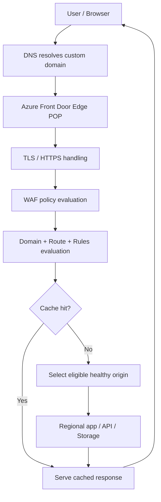
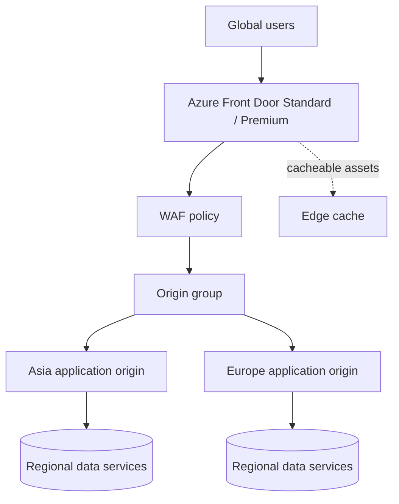
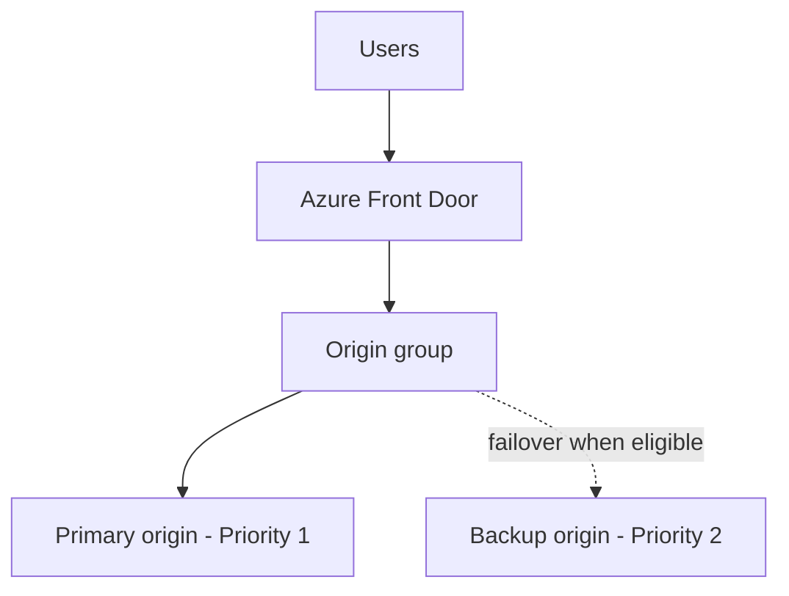
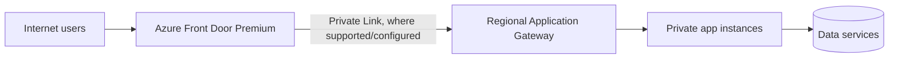
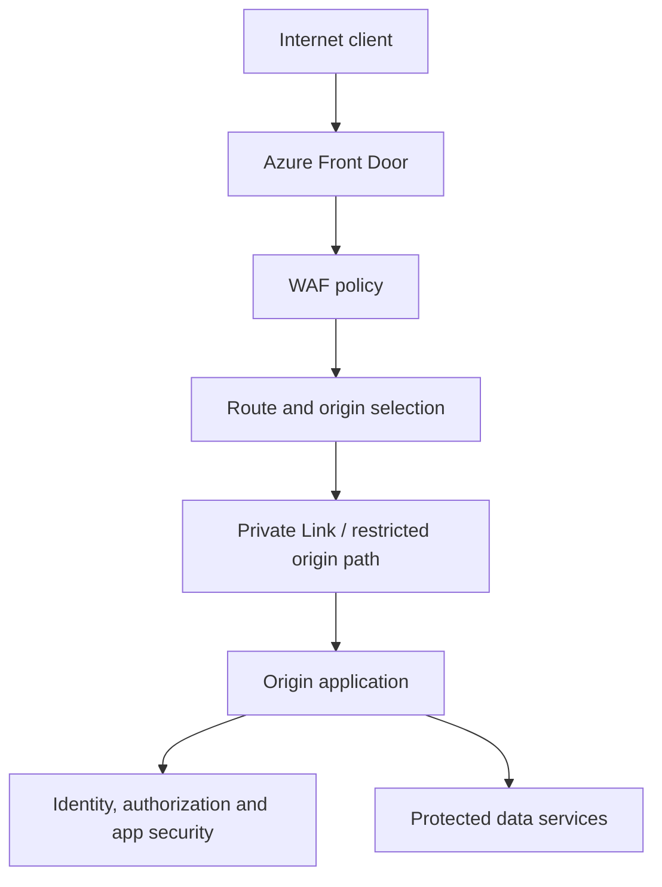
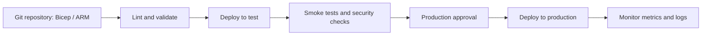

# Azure Front Door 

## Table of Contents

-   [1. Azure Front Door kya hai?](#1-azure-front-door-kya-hai)
-   [2. Real-world example](#2-real-world-example)
-   [3. Request kaise travel karti
    hai?](#3-request-kaise-travel-karti-hai)
-   [4. Architecture diagram](#4-architecture-diagram)
-   [5. Azure Front Door ke main
    components](#5-azure-front-door-ke-main-components)
-   [6. Global load balancing kaise kaam karti
    hai?](#6-global-load-balancing-kaise-kaam-karti-hai)
-   [7. Routing methods](#7-routing-methods)
-   [8. Health probes and failover](#8-health-probes-and-failover)
-   [9. CDN, caching and acceleration](#9-cdn-caching-and-acceleration)
-   [10. TLS, HTTPS and certificates](#10-tls-https-and-certificates)
-   [11. Security: WAF, DDoS and Private
    Link](#11-security-waf-ddos-and-private-link)
-   [12. Rules Engine and routing
    rules](#12-rules-engine-and-routing-rules)
-   [13. Azure Front Door vs Application Gateway vs Load
    Balancer](#13-azure-front-door-vs-application-gateway-vs-load-balancer)
-   [14. Standard vs Premium vs
    Classic](#14-standard-vs-premium-vs-classic)
-   [15. Reference architectures](#15-reference-architectures)
-   [16. Hands-on deployment plan](#16-hands-on-deployment-plan)
-   [17. CLI / IaC approach](#17-cli--iac-approach)
-   [18. Monitoring and diagnostics](#18-monitoring-and-diagnostics)
-   [19. Troubleshooting playbook](#19-troubleshooting-playbook)
-   [20. Production best practices](#20-production-best-practices)
-   [21. Cost considerations](#21-cost-considerations)
-   [22. Interview questions](#22-interview-questions)
-   [23. Glossary](#23-glossary)
-   [24. Official Microsoft
    references](#24-official-microsoft-references)

------------------------------------------------------------------------

## 1. Azure Front Door kya hai?

**Azure Front Door (AFD)** Microsoft Azure ki globally distributed,
internet-facing service hai jo web applications, websites aur APIs ke
liye **global entry point** provide karti hai. Ye Microsoft ke global
edge network par client requests receive karti hai, request ko suitable
backend tak route karti hai, aur caching/security features ke through
performance aur protection improve kar sakti hai.

Simple words mein:

-   User duniya ke kisi bhi location se website open karta hai.
-   Request Microsoft ke nearby Front Door edge point of presence (POP)
    tak pahunchti hai.
-   Front Door configured routing rules, origin health aur routing
    policy ke basis par request ko suitable origin/backend tak bhejti
    hai.
-   Static content cache se serve ho sakta hai; dynamic request origin
    tak forward hoti hai.
-   Agar configured origin unhealthy ho, Front Door eligible healthy
    origin par traffic fail over kar sakti hai.

### Front Door ko kab use karte hain?

-   Application ke users multiple countries/regions mein hain.
-   Application ke multiple regional deployments hain, jaise East US aur
    West Europe.
-   Global traffic routing aur automatic regional failover chahiye.
-   Static assets ko edge locations par cache karna hai.
-   Web Application Firewall (WAF) ke through HTTP/HTTPS traffic protect
    karna hai.
-   Application ko globally consistent HTTPS endpoint se expose karna
    hai.
-   Azure ke saath external/on-premises reachable origins bhi route
    karne hain.

### Front Door kya nahi hai?

-   Ye sirf ek VM ya regional load balancer nahi hai.
-   Ye database replication ka replacement nahi hai.
-   Ye application code ko automatically multi-region ready nahi banata.
-   Ye har request ko cache nahi karta; caching configuration aur
    response behavior par depend karti hai.
-   Ye backend ko automatically secure nahi karta agar origin ko bypass
    karke directly public access diya hua ho.
-   Ye DNS hosting ka direct replacement nahi hai, though custom domains
    ko DNS records ke saath integrate kiya jata hai.

### One-line definition

> Azure Front Door is a global Layer 7 entry point that accelerates,
> routes, and helps secure HTTP/HTTPS application traffic across
> origins.

------------------------------------------------------------------------

## 2. Real-world example

Maan lo ek e-commerce website `www.contoso.com` ke users India, Europe
aur North America mein hain. Company ke paas do regional application
deployments hain:

-   India/Asia ke liye origin: `app-asia.contoso.net`
-   Europe ke liye origin: `app-europe.contoso.net`
-   Ek static asset origin: Azure Storage
-   WAF policy: common web attack patterns filter karne ke liye

Front Door user ko ek common public hostname deta hai. Edge par request
receive hone ke baad Front Door origin group ki health aur routing
configuration check karke request ko suitable origin par bhejta hai.
Images, CSS aur JavaScript jaise cacheable assets edge cache se serve ho
sakte hain.

**Important:** Front Door origin selection sirf map par geographic
distance dekh kar nahi karta. Latency-based routing configured health
monitoring aur network latency measurements use karti hai. Actual
behavior configured priority, latency sensitivity, weights, session
affinity, rules aur origin health se influence hota hai.

------------------------------------------------------------------------

## 3. Request kaise travel karti hai?

### High-level flow

1.  User browser mein `https://www.contoso.com` enter karta hai.
2.  DNS custom domain ko Azure Front Door endpoint ke saath resolve
    karta hai.
3.  Client Microsoft global edge network ke suitable entry point se
    connect karta hai.
4.  HTTPS request par TLS connection establish hota hai.
5.  Front Door route, domain, protocol, path, rules aur WAF policy ke
    mutabiq request process karta hai.
6.  Agar valid cache entry available hai aur caching enabled/configured
    hai, response edge cache se mil sakta hai.
7.  Otherwise, Front Door origin group mein eligible origin select karta
    hai.
8.  Front Door origin ko request forward karta hai, origin TLS settings
    aur hostname configuration ke according.
9.  Origin response return karta hai; Front Door response ko client tak
    deliver karta hai.
10. Cache rules allow karti hain to eligible response cache ho sakta
    hai.

### Request flow diagram



> Diagram conceptual hai. Exact processing order aur behavior route,
> cache, WAF, Rules Engine, product tier aur configuration par depend
> kar sakta hai.

### Edge POP aur origin mein difference

  -----------------------------------------------------------------------
  Term                                Meaning
  ----------------------------------- -----------------------------------
  Edge POP                            Microsoft network ka edge location
                                      jahan client request Front Door tak
                                      pahunchti hai

  Origin                              Actual backend endpoint jo
                                      application/content serve karta hai

  Origin group                        Related origins ka group jiske
                                      against health monitoring aur
                                      routing policy configure hoti hai

  Cache                               Edge par temporarily stored
                                      eligible content

  Route                               Frontend domain/path ko origin
                                      group aur supported route behavior
                                      se connect karta hai
  -----------------------------------------------------------------------

------------------------------------------------------------------------

## 4. Architecture diagram

### Global active-active architecture



**Active-active** ka matlab multiple origins normal operations mein
traffic serve kar sakte hain. Lekin architecture tabhi genuinely
resilient hai jab data layer, identity, configuration, dependencies aur
deployment process bhi failure handle kar sakein.

### Active-passive architecture



Priority 1 origin healthy hai to traffic normally usi ko prefer kiya
jata hai. Agar higher-priority origin unavailable/unhealthy ho, Front
Door next eligible priority par route kar sakti hai.

### Front Door + Application Gateway + private backend



Ye pattern tab useful ho sakta hai jab global edge routing ke saath
region ke andar advanced Layer 7 routing ya WAF capabilities chahiye.
Private Link support aur origin type ko selected tier, region aur
current feature support ke against verify karein. Har architecture mein
Front Door se Application Gateway tak Private Link automatically
available nahi hota; configuration requirements validate karna zaroori
hai.

------------------------------------------------------------------------

## 5. Azure Front Door ke main components

### 5.1 Front Door profile

Profile top-level resource hai jahan tier aur related Front Door
configuration organize hoti hai. Standard/Premium profile mein
endpoints, custom domains, origin groups, routes, rules aur
security-related resources configure hote hain.

### 5.2 Endpoint / frontend host

Endpoint Front Door ka generated hostname hota hai, commonly
`something.azurefd.net` format mein. Custom domain, jaise
`www.contoso.com`, is endpoint par configure kiya ja sakta hai.

### 5.3 Custom domain

Custom domain users ko familiar hostname deta hai. Domain ownership
validate karni hoti hai aur DNS records ko Front Door endpoint ke
according configure karna hota hai. HTTPS ke liye certificate
association/provisioning bhi required hoti hai.

### 5.4 Origin

Origin woh backend hai jo request ka actual response generate karta hai.
Example:

-   Azure App Service
-   Azure Storage static website endpoint
-   Azure API Management
-   Application Gateway
-   Publicly reachable custom/on-premises application endpoint

Origin hostname, origin host header, ports, certificate validation aur
network accessibility correctly configure karna important hai.

### 5.5 Origin group

Origin group related origins ko logically group karta hai. Is group ke
liye health probes aur load-balancing/routing settings configure hoti
hain. Agar multiple origins hain, Front Door eligible origins ke beech
configured routing method ke basis par traffic distribute kar sakta hai.

### 5.6 Route

Route frontend domain/endpoint ko origin group se connect karti hai.
Route configuration mein commonly ye decisions hote hain:

-   Kaunse domain(s) match honge?
-   Kaunse URL paths match honge?
-   HTTP aur HTTPS ka behavior kya hoga?
-   Kaunsa origin group use hoga?
-   Caching enable/configure karni hai ya nahi?
-   Supported rules association kaise apply hogi?

### 5.7 Health probe

Health probe origin ki availability test karne ke liye periodic request
hoti hai. Probe protocol, path, method, interval aur expected response
ko carefully choose karein. Health endpoint lightweight aur meaningful
hona chahiye.

### 5.8 Rules Engine / Rules set

Rules request ya response attributes ke basis par behavior customize kar
sakti hain, jaise:

-   URL/path rewrite
-   Redirects
-   Request/response header changes
-   Route/origin-group override, where supported
-   Specific path ke liye special behavior

Available match conditions aur actions tier/API version ke saath vary
kar sakte hain; deployment se pehle official feature documentation check
karein.

### 5.9 WAF policy

Web Application Firewall HTTP/HTTPS requests ko configured
managed/custom rules ke against inspect karta hai. WAF malicious
patterns ko log, block ya policy ke mode ke according handle kar sakta
hai. WAF ko test aur tune karna chahiye, warna legitimate traffic false
positive ke through block ho sakta hai.

### 5.10 Cache configuration

Caching policy determine karti hai ki eligible responses cache ho sakte
hain ya nahi, aur cache key/content freshness kaise handle hoti hai.
Personalized, authenticated ya sensitive responses ko carefully evaluate
kiye bina cache na karein.

------------------------------------------------------------------------

## 6. Global load balancing kaise kaam karti hai?

Regional load balancer usually ek region ke andar backend instances ke
beech traffic distribute karta hai. Azure Front Door **global HTTP/HTTPS
entry point** hai jo clients ko Microsoft edge network par receive karke
configured origins ke beech route karta hai.

Front Door ka origin selection in factors se influence ho sakta hai:

1.  **Origin enabled/disabled status**
2.  **Health probe results**
3.  **Priority** --- active/passive scenarios ke liye
4.  **Latency sensitivity** --- acceptable latency range define karne ke
    liye
5.  **Weights** --- eligible origins ke beech relative traffic share ke
    liye
6.  **Session affinity** --- same client ko same origin par continue
    rakhne ke liye, if enabled
7.  **Rules and route configuration** --- request ke liye selected
    origin group ko affect kar sakte hain

### Important distinction

Front Door user ko globally closest edge par accept kar sakta hai, lekin
iska matlab ye nahi ki request hamesha geographically closest origin par
hi jayegi. Origin routing network latency aur configured policies par
depend karti hai.

### Example: weighted routing

Suppose eligible origins ke weights hain:

-   Origin A = 70
-   Origin B = 30

Agar dono origins routing ke latency criteria ko meet karte hain,
traffic ka intended relative split approximately 70:30 ho sakta hai.
Distributed edge infrastructure, low request volume, health changes aur
latency sensitivity ki wajah se short time windows mein exact
percentages guarantee nahi hoti.

### Example: priority routing

-   Primary origin priority = 1
-   Backup origin priority = 2

Primary healthy hai to Front Door usko prefer karti hai. Primary
unavailable hone par backup eligible ho sakta hai. Failover behavior
health detection, connection errors aur request retry rules par depend
karta hai; zero-downtime guarantee assume na karein.

------------------------------------------------------------------------

## 7. Routing methods

Azure Front Door origin group ke liye commonly four routing concepts
important hain.

### 7.1 Latency-based routing

Request ko eligible origins mein se low network latency wale origin ki
taraf route karne ke liye use hota hai.

**Use when:** Multiple regions mein same application deployed ho aur
responsiveness important ho.

**Caution:** Geographic distance aur network latency same cheez nahi
hain. Actual result network path, origin health aur latency sensitivity
se affect hota hai.

### 7.2 Priority-based routing

Origins ko priority values di jati hain. Lower number higher priority
indicate karta hai, for example priority 1 primary aur priority 2
backup.

**Use when:** Active-passive DR ya primary/standby architecture chahiye.

**Caution:** Backup origin tabhi useful hai jab woh tested, provisioned,
data-compatible aur failover traffic handle karne ke liye ready ho.

### 7.3 Weighted routing

Eligible origins ko configured weights ke proportion mein traffic
distribute karne ke liye use hota hai.

**Use when:** - Gradual migration - Canary rollout - A/B-like
infrastructure split (application logic separately designed ho) -
Multiple origin capacity ko relative proportion mein use karna

**Caution:** Ye per-user deterministic percentage guarantee nahi hai.
Very low request rates par observed distribution skewed lag sakta hai.

### 7.4 Session affinity

Same client session ke subsequent requests ko same origin par route
karne mein help karti hai.

**Use when:** Application temporarily server-local session state par
depend karti hai aur application changes immediately possible nahi hain.

**Prefer:** Stateless application design aur distributed session store.
Affinity load distribution ko restrict kar sakti hai aur origin failure
par user experience impact ho sakta hai.

### Routing method quick comparison

  -----------------------------------------------------------------------
  Method                  Main purpose            Typical pattern
  ----------------------- ----------------------- -----------------------
  Latency                 Lower network latency   Multi-region
                          wale eligible origin ko active-active
                          prefer karna            

  Priority                Primary ko prefer,      Active-passive DR
                          backup ko failover      

  Weighted                Eligible origins ke     Migration/canary
                          beech relative traffic  
                          split                   

  Session affinity        Same session ko same    Legacy/stateful session
                          origin se associate     behavior
                          rakhna                  
  -----------------------------------------------------------------------

------------------------------------------------------------------------

## 8. Health probes and failover

Health probes Front Door ko ye samajhne mein help karti hain ki origin
traffic serve karne ke liye available hai ya nahi.

### Health probe configure karte waqt

-   Aisa path choose karein jo stable ho, e.g. `/health`.
-   Probe ko unnecessarily heavy database query ya expensive operation
    na banayein.
-   Agar application ko database, cache ya critical dependency ki
    zaroorat hai, decide karein ki readiness endpoint un dependencies ko
    check karega ya nahi.
-   `HEAD` request use karna possible ho to consider karein, kyunki
    response body download karne ki zaroorat kam hoti hai.
-   Probe frequency ko origin capacity aur detection needs ke balance
    mein configure karein.
-   Sirf ek origin ho to probe status routing ko alternate origin par
    switch nahi kar sakta; unnecessary probes origin par load badha
    sakti hain.

### Liveness vs readiness

-   **Liveness:** Process alive hai?
-   **Readiness:** Application actual traffic serve karne ke liye ready
    hai?

Front Door health endpoint ko application ke intended failover semantics
ke saath design karein. Agar readiness check too strict hai, transient
dependency issue ke waqt multiple origins unhealthy ho sakte hain. Agar
too weak hai, unhealthy application ko traffic milta reh sakta hai.

### Failover limitations

Health probes instant failure detection ki guarantee nahi deti.
Detection interval, probe behavior, network errors, connection retries
aur application failure mode matter karte hain. Failover ke baad data
consistency, active sessions aur writes ka behavior application
architecture ki responsibility hai.

------------------------------------------------------------------------

## 9. CDN, caching and acceleration

Front Door CDN-like edge caching aur dynamic traffic acceleration
capabilities provide kar sakta hai.

### Static content

Examples:

-   Logos and images
-   CSS and JavaScript bundles
-   Downloadable public files
-   Versioned static assets

Static content caching origin load aur repeated data transfer reduce kar
sakti hai, aur user ko edge se content milne ki wajah se latency improve
ho sakti hai.

### Dynamic content

Examples:

-   User dashboard
-   Cart contents
-   Account details
-   Personalized API responses

Dynamic requests usually origin tak forward hoti hain, unless
specifically supported/configured behavior applies. Dynamic site
acceleration transport/network optimizations se benefit de sakti hai,
but every request is not cacheable.

### Cache key

Cache key define karti hai ki requests ko cache lookup ke liye kaise
distinguish kiya jata hai. Query strings, compression, headers aur route
cache settings ka behavior application ki needs ke according validate
karein.

### Caching safety checklist

-   Personalized/authenticated responses ko accidentally shared cache
    mein store na hone dein.
-   `Cache-Control` headers ko samjhein.
-   Query string ko ignore karna ya include karna deliberately choose
    karein.
-   Cache invalidation/purge strategy define karein.
-   Static asset names mein content hashing/versioning use karein,
    e.g. `app.8f31a2.js`.
-   Cache hit ratio aur origin load monitor karein.
-   Sensitive data ke caching behavior ko security review se pass
    karayein.

### Example

`/assets/logo.svg` cacheable ho sakta hai. `/account/profile` usually
personalized hota hai aur isko shared cache se serve karna unsafe ho
sakta hai unless carefully designed and configured.

------------------------------------------------------------------------

## 10. TLS, HTTPS and certificates

TLS client aur Front Door ke beech secure connection establish karta
hai. Front Door se origin tak separate TLS connection bhi configure ki
ja sakti hai.

### TLS termination

Client HTTPS connection Front Door edge par terminate hota hai. Front
Door request inspect/process karke origin ko forward karti hai.

### End-to-end TLS

Client-to-Front Door TLS ke saath Front Door-to-origin TLS bhi use hota
hai. Production systems mein sensitive traffic ke liye origin connection
encryption aur certificate validation ko correctly configure karna
important hai.

### Certificate and hostname checks

-   Custom domain correctly validated ho.
-   Certificate hostname domain se match kare.
-   Certificate valid aur trusted chain ke saath ho.
-   Origin hostname aur origin host header settings intentionally
    configured hon.
-   Origin TLS validation ko disable karna default troubleshooting
    shortcut na banayein.
-   Certificate rotation ke baad end-to-end request test karein.

### HTTP to HTTPS redirect

HTTP requests ko HTTPS par redirect karne ka route/rule behavior
configure karein. Redirect loop avoid karne ke liye origin aur Front
Door protocol settings ko consistent rakhein.

### Common TLS issues

-   Domain certificate pending/invalid
-   Hostname mismatch
-   Origin certificate chain not trusted
-   Wrong origin host header
-   Origin accepts HTTPS on a different port than configured
-   Certificate recently rotated but origin configuration still stale

------------------------------------------------------------------------

## 11. Security: WAF, DDoS and Private Link

### 11.1 Web Application Firewall (WAF)

WAF HTTP/HTTPS requests ko web attack patterns aur configured security
rules ke against evaluate karta hai. Azure Front Door ke saath WAF
policy attach ki ja sakti hai.

Potential protections include: - Common web exploit patterns - SQL
injection-like payloads - Cross-site scripting (XSS) patterns - Rate
limiting, where supported/configured - Custom rule conditions, such as
selected host/path/IP attributes - Bot-related protection features
depending on tier and configuration

WAF perfect security guarantee nahi hai. Application authentication,
authorization, secure coding, patching, secret management aur backend
network controls bhi zaroori hain.

### Detection vs prevention

-   **Detection mode:** Matching activity log/observe karne ke liye
    useful; traffic generally block nahi hota.
-   **Prevention mode:** Matching rules ke according requests block ho
    sakti hain.

Recommended rollout: 1. Policy ko test/staging environment mein validate
karein. 2. Logs aur false positives review karein. 3. Narrow, justified
exclusions use karein. 4. Production mein prevention mode enable karein
with monitoring. 5. Regularly rules, logs aur security requirements
review karein.

### 11.2 Origin bypass protection

Agar attacker Front Door ko bypass karke origin ke public IP/hostname
par directly request bhej sakta hai, to WAF/routing controls bypass ho
sakte hain.

Mitigation options architecture ke according: - Private Link to
supported origins (Premium and supported origin scenarios) - Origin
firewall/network access restrictions - Origin par Front Door se expected
traffic validate karna - Correct host-header and application-level
validation - Least-privilege network exposure

Sirf `Host` header check karna complete security boundary nahi hai.
Origin network exposure ko independently secure karein.

### 11.3 DDoS

Front Door Microsoft global edge network ke through network-level DDoS
protection capabilities provide karta hai. HTTP-layer attacks ke liye
WAF aur application-specific rate limiting/security controls consider
karein. Required protection scope aur service terms current Microsoft
docs se validate karein.

### 11.4 Azure Private Link

Azure Front Door Premium supported origins ke saath Private Link
integration provide kar sakta hai, jisse origin ko public internet par
directly expose karne ki need reduce ho sakti hai. Supported origin
type, region, approval flow aur exact architecture prerequisites
deployment se pehle verify karein.

### Security layers



------------------------------------------------------------------------

## 12. Rules Engine and routing rules

Rules request attributes ko evaluate karke additional behavior apply kar
sakti hain.

### Common examples

-   HTTP to HTTPS redirect
-   `/old-path` ko `/new-path` par redirect
-   Request headers add/update/remove
-   Response headers set/remove
-   Specific paths ko dedicated origin group par route karna, where
    supported
-   Cache behavior ko route and rules design ke saath coordinate karna

### Example: URL routing idea

-   `/api/*` → API origin group
-   `/images/*` → static content origin group
-   `/shop/*` → web app origin group

Actual route matching, wildcard syntax aur rule precedence ko selected
configuration ke official docs ke saath verify karein.

### Rules design best practices

-   Rules ko small, named aur understandable rakhein.
-   Overlapping conditions ka precedence test karein.
-   Redirect loops aur rewrite loops prevent karein.
-   Origin host header ko blindly rewrite na karein.
-   Production mein deploy karne se pehle representative requests test
    karein.
-   Logs aur synthetic tests ke through behavior verify karein.

------------------------------------------------------------------------

## 13. Azure Front Door vs Application Gateway vs Load Balancer

Ye services ek dusre ka direct replacement har scenario mein nahi hain.
Inka scope aur layer alag hai.

  --------------------------------------------------------------------------
  Feature           Azure Front Door  Application Gateway Azure Load
                                                          Balancer
  ----------------- ----------------- ------------------- ------------------
  Primary scope     Global edge       Regional / virtual  Regional network
                                      network entry       load balancing

  Main layer        Layer 7           Layer 7 HTTP/HTTPS  Layer 4 TCP/UDP
                    HTTP/HTTPS                            

  Typical use       Global web        Regional web        High-performance
                    acceleration and  routing and WAF     TCP/UDP
                    routing                               distribution

  Global routing    Yes               Not by itself       Not by itself

  URL path routing  Yes, route/rules  Yes                 No
                    features                              

  Host-based web    Yes               Yes                 No HTTP host
  routing                                                 routing

  Edge caching/CDN  Yes               No                  No

  Web Application   Front Door WAF    Application Gateway No built-in WAF
  Firewall                            WAF                 

  Private regional  Via supported     Yes, regional VNet  Yes
  backend           origin/network    pattern             
                    design                                

  TCP/UDP non-HTTP  Not its primary   Not its primary     Yes
  workload          purpose           purpose             

  Common            Internet → Front  Internet/internal → Clients → L4
  architecture      Door → origins    App Gateway → app   backend pool
  --------------------------------------------------------------------------

### Kab kya choose karein?

**Azure Front Door choose karein** jab global HTTP/HTTPS routing, edge
acceleration/caching, global failover aur edge WAF important ho.

**Application Gateway choose karein** jab regional Layer 7 routing,
VNet-integrated entry, URL-based routing ya regional WAF chahiye.

**Azure Load Balancer choose karein** jab TCP/UDP Layer 4 traffic ko
backend instances ke beech distribute karna ho.

### Combine bhi kar sakte hain

Global users → Azure Front Door → regional Application Gateway → private
application instances.

Is design mein Front Door global edge responsibilities handle karti hai
aur Application Gateway regional Layer 7 traffic handling kar sakta hai.
Extra hops, cost, TLS configuration, routing complexity aur
troubleshooting overhead ko consider karein.

------------------------------------------------------------------------

## 14. Standard vs Premium vs Classic

For new designs, generally **Azure Front Door Standard or Premium**
evaluate karein. Classic legacy tier hai aur Microsoft ke documented
schedule ke mutabiq **March 31, 2027** ko retire hota hai. Classic par
new profile creation, new domain onboarding aur managed certificates ke
restrictions bhi documented hain. Existing Classic deployment ho to
migration planning delay na karein.

  ------------------------------------------------------------------------
  Capability        Standard          Premium            Classic
  ----------------- ----------------- ------------------ -----------------
  Modern Front Door Yes               Yes                Legacy tier
  profile                                                

  Global HTTP/HTTPS Yes               Yes                Yes
  routing                                                

  CDN and           Yes               Yes                Legacy feature
  acceleration                                           model

  WAF               Available,        Enhanced security  Legacy feature
                    tier/feature      feature set        model
                    scope verify                         
                    karein                               

  Azure Private     Not the primary   Supported          Not equivalent to
  Link origin       tier              scenarios          Premium model
  integration       differentiator                       

  Advanced security More limited      Broader feature    Legacy feature
  / bot                               set                model
  capabilities                                           

  Recommended for   Consider          Consider when      No; plan
  new design                          advanced           migration
                                      security/private   
                                      origin features    
                                      needed             
  ------------------------------------------------------------------------

**Tier selection rule of thumb:** - Standard: global delivery and
routing requirements with standard security needs. - Premium: advanced
WAF/security requirements and supported Private Link origin scenarios. -
Classic: existing deployments only; migration to Standard/Premium plan
karein.

Exact feature availability can evolve; confirm current Microsoft tier
comparison and regional support before purchase/deployment.

------------------------------------------------------------------------

## 15. Reference architectures

### Pattern A --- Single-region web app with global edge

**Use when:** Application currently has one origin, but needs custom
domain, HTTPS, WAF and edge caching.

Components: - Azure Front Door Standard/Premium - One origin (App
Service, Storage, or another supported endpoint) - Custom domain and
certificate - WAF policy if required - Cache rules for static assets

**Limitation:** Front Door cannot fail over to another region if no
alternative origin exists. With one origin, health probes do not create
redundancy.

### Pattern B --- Multi-region active-active

**Use when:** Both regions can process production traffic.

Components: - Front Door endpoint and custom domain - Origin group with
two or more regional origins - Health probes - Latency or weighted
routing - Data layer that supports the active-active model - Monitoring,
alerts, and deployment automation

Validate data writes, conflict handling, identity/session behavior,
secrets, configuration parity, and regional dependencies.

### Pattern C --- Primary/DR

**Use when:** One region is primary and another is disaster recovery.

Components: - Origin group with priority 1 primary and priority 2
secondary - Meaningful readiness probe - Replicated/restore-ready data -
Documented failover and failback process - DR testing and RTO/RPO
objectives

Front Door origin failover alone is not a complete disaster recovery
plan.

### Pattern D --- Static content + dynamic APIs

-   Static content origin/cache configuration for `/assets/*`
-   API origin group for `/api/*`
-   Dynamic routes configured to avoid accidental caching
-   WAF policy for web/API traffic
-   Cache invalidation strategy for versioned assets

### Pattern E --- Global edge + regional application gateway

Use when global delivery is needed, plus regional routing or private
VNet entry. Validate the exact origin type and Private Link support if
the design requires a private origin path.

------------------------------------------------------------------------

## 16. Hands-on deployment plan

This is a planning checklist; exact portal labels may evolve.

### Step 1: Prepare origins

-   Deploy the web app/API in the intended region(s).
-   Test origin URL directly from an authorized network.
-   Confirm application health endpoint.
-   Ensure origin accepts the expected host header and protocol.
-   Decide whether origin is public or privately reachable.

### Step 2: Create Front Door profile

-   Choose Standard or Premium based on requirements.
-   Name the profile and endpoint clearly.
-   Select the correct subscription/resource group.
-   Review security and billing requirements.

### Step 3: Create origin group

-   Add origin endpoint(s).
-   Configure origin host header intentionally.
-   Set HTTP/HTTPS ports and certificate validation settings.
-   Configure health probe path, method and interval.
-   Choose routing policy: latency, priority, weighted, affinity as
    needed.

### Step 4: Create route

-   Associate the endpoint/domain.
-   Select matching path patterns.
-   Connect route to origin group.
-   Configure HTTP-to-HTTPS redirect behavior.
-   Decide caching and compression settings.
-   Attach rules set if required.

### Step 5: Configure custom domain and HTTPS

-   Add custom domain.
-   Complete domain validation.
-   Configure DNS according to the current Front Door guidance.
-   Enable/associate managed or supported certificate.
-   Verify HTTPS and certificate hostname.

### Step 6: Configure security

-   Associate WAF policy.
-   Test detection/logging behavior.
-   Review false positives before prevention mode.
-   Restrict direct origin access.
-   Use Private Link for supported Premium origin scenarios if required.

### Step 7: Test

-   Test main page, API routes and static assets.
-   Verify response headers and cache behavior.
-   Test health-probe failure and failover in a controlled environment.
-   Test direct-origin access restrictions.
-   Validate TLS from client to edge and edge to origin.
-   Check logs/metrics and configure alerts.

### Step 8: Production readiness

-   Define SLOs, RTO and RPO.
-   Configure monitoring and alert ownership.
-   Document rollback and failback steps.
-   Review cost estimates and traffic assumptions.
-   Add configuration to IaC and version control.

------------------------------------------------------------------------

## 17. CLI / IaC approach

Azure Front Door configuration can be automated using Azure Resource
Manager (ARM) templates, Bicep, Azure CLI, PowerShell, SDKs and
supported APIs.

### Recommended automation strategy

1.  Pin and document tool/API versions used by your organization.
2.  Keep profile, endpoint, origin group, origin, route, WAF policy and
    rules configuration in version control.
3.  Separate dev/test/prod parameters.
4.  Use least-privilege role assignments.
5.  Avoid storing secrets or certificate private keys in plain text.
6.  Validate templates before deployment.
7.  Deploy to a non-production environment first.
8.  Run smoke tests after deployment.
9.  Use controlled change approvals for production.

### Example deployment workflow



### Example CLI discovery commands

CLI command groups and parameters may evolve; check the installed Azure
CLI version and current official reference before using commands in
production.

``` bash
# Sign in
az login

# Select subscription
az account set --subscription "<subscription-id>"

# Discover Front Door-related command groups
az afd --help

# Inspect available commands for profiles
az afd profile --help
```

Treat these as discovery examples rather than a complete deployment
script. Production automation should include all required dependencies
and be tested in a non-production subscription.

------------------------------------------------------------------------

## 18. Monitoring and diagnostics

Production Front Door deployments should be observable. Enable supported
diagnostic logs and metrics and route them to a suitable destination
such as Log Analytics where required.

### Monitor these areas

-   Request volume and response status codes
-   Origin health and health probe failures
-   Latency and response time
-   Cache hit ratio / cache behavior, where available
-   Origin response status and connection errors
-   WAF matches and blocked requests
-   Traffic by domain, route, geography or status, where available
-   Certificate and custom domain status
-   Unexpected traffic spikes and cost trends

### Alert ideas

-   5xx responses exceed a baseline threshold
-   Origin health changes to unhealthy
-   Latency exceeds an agreed SLO
-   WAF block volume rises sharply
-   Traffic deviates significantly from expected patterns
-   Origin request volume spikes, possibly indicating cache bypass or
    traffic surge

### Observability principle

Do not rely on a single metric. For example, a high 5xx count may be
caused by an origin application issue, TLS misconfiguration, an
unreachable origin, an incorrect host header, or a routing rule error.
Correlate Front Door logs with origin/application logs and deployment
timestamps.

------------------------------------------------------------------------

## 19. Troubleshooting playbook

### Problem: Front Door returns 502

Potential causes: - Origin unreachable - Origin host header incorrect -
TLS handshake or certificate validation issue - Origin service not
listening on configured port - Origin application resets the
connection - Network/firewall restrictions block traffic

Investigate: 1. Check origin health and probe details. 2. Test the
origin endpoint from a permitted path. 3. Verify origin hostname, host
header, port and protocol. 4. Validate certificate trust and hostname.
5. Review Front Door diagnostics and origin logs. 6. Check recent
deployments, DNS changes and firewall rules.

### Problem: Front Door returns 503

Potential causes: - No eligible healthy origin - Origin group
configuration issue - Origin capacity or application availability
problem

Investigate health probes, origin enabled state, routing configuration,
origin capacity and recent changes.

### Problem: Front Door returns 504 or requests time out

Potential causes: - Slow origin response - Backend dependency timeout -
Network connection issue - Application request taking too long

Measure time spent in the origin and dependencies. Optimize
application/database calls, verify timeouts, and confirm whether the
issue affects one route, one region or all requests.

### Problem: One region receives unexpected traffic

Check: - Origin health state - Priority values - Latency sensitivity -
Weight values - Session affinity - Route/rules overrides - Whether
traffic volume is sufficient for weights to look statistically stable

### Problem: HTTPS fails for custom domain

Check: - DNS record and domain validation - Certificate
provisioning/association status - Certificate subject/SAN matches the
hostname - TLS settings and client behavior - Recent DNS or certificate
changes

### Problem: WAF blocks legitimate requests

Check: - WAF logs and rule ID - Which request field matched - Whether
the behavior is a genuine false positive - Whether a narrow exclusion or
custom rule adjustment is appropriate

Avoid disabling the entire WAF policy as the first response. Make the
smallest justified change and retest.

### Problem: Stale content is served

Check: - Cache enabled on the relevant route - Cache-Control behavior -
Cache key and query string settings - Content versioning and purge
process - Whether the response should have been cached at all

### Problem: Origin works directly but fails through Front Door

Check: - Origin host header - TLS certificate and hostname - Allowed
source/network access - Health probe path/method/status - HTTP/HTTPS
port mismatch - Redirects that send clients or Front Door to an
unexpected hostname - Rules and route associations

------------------------------------------------------------------------

## 20. Production best practices

### Architecture

-   Choose Standard/Premium based on actual requirements, not just
    feature count.
-   Deploy multiple origins when regional redundancy is required.
-   Make the data layer and dependencies resilient too.
-   Test failover and failback regularly.
-   Keep origins as close to the intended users/traffic patterns as
    practical.
-   Avoid unnecessary layers unless they provide a clear capability.

### Health probes

-   Use a lightweight, purpose-built readiness endpoint.
-   Consider `HEAD` when supported and appropriate.
-   Include only dependencies necessary to determine readiness.
-   Disable probes when a single origin makes probe-based failover
    useless, where appropriate.
-   Monitor probe status and origin application health together.

### Security

-   Attach and tune WAF policy according to application risk.
-   Restrict direct origin access; don't assume Front Door alone
    prevents bypass.
-   Use end-to-end TLS where required.
-   Use managed identity/least privilege for supported integrations.
-   Keep secrets out of code and deployment logs.
-   Review WAF logs and security rules continuously.

### Caching

-   Cache public static assets.
-   Use versioned asset filenames.
-   Never assume personalized responses are safe to share in cache.
-   Define query-string behavior deliberately.
-   Test purge/invalidation and cache-control behavior.

### Reliability and performance

-   Define SLO, RTO and RPO before choosing architecture.
-   Test failure scenarios rather than relying on diagrams alone.
-   Monitor 4xx/5xx, origin health, latency and cache behavior.
-   Avoid session affinity unless the application genuinely requires it.
-   Ensure the origin can handle cold-cache traffic and regional
    failover surges.

### Operations

-   Use IaC for repeatable deployment.
-   Separate environments and change permissions.
-   Keep runbooks for DNS, TLS, WAF, origin and failover incidents.
-   Review cost and traffic trends regularly.
-   Validate feature/tier availability before deployment.

------------------------------------------------------------------------

## 21. Cost considerations

Azure Front Door cost depends on selected tier, base/profile charges
where applicable, request volume, data transfer, geographic zones,
security features and usage details. Exact prices can change, so use the
official Azure pricing page and pricing calculator for the target
subscription, currency and traffic pattern.

### Main cost drivers to model

-   Standard vs Premium tier
-   Number and volume of requests
-   Edge-to-client data transfer
-   Edge-to-origin transfer where billable
-   WAF/security feature usage and associated pricing model
-   Logs and analytics retention/storage
-   Origin compute, storage and network egress costs
-   Additional regional infrastructure such as Application Gateway

### Cost optimization

-   Cache eligible static content.
-   Use compression where beneficial.
-   Avoid expensive, unnecessary health-probe endpoints.
-   Review logs retention and diagnostic destination costs.
-   Avoid adding multiple routing layers without a clear requirement.
-   Forecast normal and peak traffic, including failover events.
-   Recheck current prices before implementation.

Official pricing: https://azure.microsoft.com/pricing/details/frontdoor/

------------------------------------------------------------------------

## 22. Interview questions

### Basic

1.  What is Azure Front Door?
2.  What is the difference between an origin and an origin group?
3.  What is an endpoint in Azure Front Door?
4.  What is a route?
5.  What is an edge POP?
6.  What is the difference between Front Door and Azure Load Balancer?
7.  What is CDN caching?
8.  What is a health probe?
9.  What is a custom domain?
10. What is TLS termination?

### Intermediate

1.  Explain latency-based, priority-based and weighted routing.
2.  How does Front Door decide which origin can receive traffic?
3.  What happens when an origin becomes unhealthy?
4.  How would you configure primary and secondary origins?
5.  What is session affinity, and why might it be discouraged?
6.  How do cache keys affect content delivery?
7.  How do you prevent HTTP traffic from remaining unencrypted?
8.  What is the purpose of a WAF policy?
9.  How would you protect an origin from direct public access?
10. What is the difference between Front Door and Application Gateway?

### Advanced / scenario-based

1.  Users in one region receive 502 errors while another region works.
    How would you troubleshoot?
2.  How would you design global active-active routing for a stateless
    API?
3.  How would you design a primary/DR architecture using priority
    routing?
4.  What happens if both origins share the same priority and one has
    lower latency?
5.  How would you gradually migrate traffic from an old origin to a new
    origin?
6.  How would you avoid caching personalized user responses?
7.  How would you troubleshoot a WAF false positive?
8.  How would you configure Front Door Premium with a private origin?
9.  How do you distinguish an origin health issue from a TLS issue?
10. What is your end-to-end plan for testing regional failover?
11. When would you combine Front Door with Application Gateway?
12. How would you reduce origin load and improve cache hit ratio?
13. How would you migrate from Front Door Classic to Standard/Premium?
14. What are the risks of relying on Front Door failover without
    data-layer DR?
15. How would you plan cost and observability for a global production
    deployment?

------------------------------------------------------------------------

## 23. Glossary

  -----------------------------------------------------------------------
  Term                                Simple meaning
  ----------------------------------- -----------------------------------
  AFD                                 Azure Front Door

  POP                                 Point of Presence; edge location in
                                      the network

  Origin                              Backend endpoint that serves the
                                      application/content

  Origin group                        Group of related origins with
                                      shared health/routing configuration

  Route                               Connects frontend domain/path
                                      behavior to an origin group

  Health probe                        Periodic request used to assess
                                      origin health

  Failover                            Moving traffic to an alternate
                                      eligible origin after failure

  CDN                                 Content Delivery Network

  Cache hit                           Requested content is available in
                                      cache

  Cache miss                          Content needs to be fetched from
                                      origin

  TLS                                 Protocol that secures network
                                      communication

  WAF                                 Web Application Firewall

  Private Link                        Private connectivity capability for
                                      supported Azure services

  Active-active                       Multiple deployments serve normal
                                      production traffic

  Active-passive                      Primary serves traffic; standby is
                                      available for failover

  RTO                                 Recovery Time Objective; target
                                      time to restore service

  RPO                                 Recovery Point Objective;
                                      acceptable data-loss window

  IaC                                 Infrastructure as Code

  SLO                                 Service Level Objective
  -----------------------------------------------------------------------

------------------------------------------------------------------------

## 24. Official Microsoft references

Use Microsoft Learn as the source of truth for current capabilities,
supported regions, tier differences, API versions and deployment steps.

1.  **Azure Front Door documentation**\
    https://learn.microsoft.com/en-us/azure/frontdoor/

2.  **What is Azure Front Door?**\
    https://learn.microsoft.com/en-us/azure/frontdoor/front-door-overview

3.  **Traffic routing methods for origins**\
    https://learn.microsoft.com/en-us/azure/frontdoor/routing-methods

4.  **Best practices for Azure Front Door**\
    https://learn.microsoft.com/en-us/azure/frontdoor/best-practices

5.  **Architecture best practices (Azure Well-Architected Framework)**\
    https://learn.microsoft.com/en-us/azure/well-architected/service-guides/azure-front-door

6.  **Azure Front Door Classic retirement FAQ**\
    https://learn.microsoft.com/en-us/azure/frontdoor/classic-retirement-faq

7.  **Migrate Azure Front Door Classic to Standard/Premium**\
    https://learn.microsoft.com/en-us/azure/frontdoor/migrate-tier

8.  **Azure Front Door pricing**\
    https://azure.microsoft.com/pricing/details/frontdoor/

9.  **Azure Front Door pricing model comparison**\
    https://learn.microsoft.com/en-us/azure/frontdoor/understanding-pricing

10. **Azure Load Balancer documentation**\
    https://learn.microsoft.com/en-us/azure/load-balancer/

11. **Azure Application Gateway documentation**\
    https://learn.microsoft.com/en-us/azure/application-gateway/

------------------------------------------------------------------------

## Final takeaway

Azure Front Door ko ek **global HTTP/HTTPS entry point** samjho jo
Microsoft edge network par client traffic receive karke routing,
caching, acceleration aur security capabilities provide karta hai.

-   **Global web routing, edge caching, global failover:** Azure Front
    Door
-   **Regional Layer 7 routing and WAF:** Azure Application Gateway
-   **Regional Layer 4 TCP/UDP load balancing:** Azure Load Balancer
